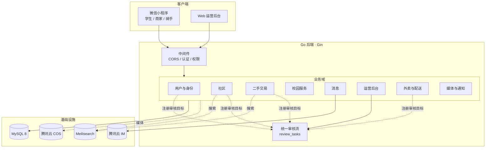

# 湛科生活圈 · Campus Circle

> 面向高校的一站式校园生活平台。学生在一个微信小程序里逛社区、淘二手、点外卖、用校园服务；商家和骑手在同一小程序内以身份切换接单履约；运营团队在 Web 后台完成审核、用户管理、资金结算与平台配置。

**微信小程序（Taro 4 + React 18）** · **Web 运营后台（React 18 + Vite）** · **Go 后端（Gin + Gorm）** · **MySQL 8** · **Meilisearch** · **腾讯云 COS / IM** · **Docker**

---

## 平台形态

| 端 | 使用者 | 主要能力 |
| --- | --- | --- |
| 微信小程序 | 学生 / 普通用户 | 社区、二手交易、外卖与跑腿下单、校园服务、私信 |
| 微信小程序 | 商家 | 店铺与菜品、发跑腿单、订单处理、钱包与结算 |
| 微信小程序 | 骑手 | 抢单配送、履约进度、收入与提现 |
| Web 后台 | 运营 / 管理员 | 经营总览、内容审核、用户与认证管理、通知与素材、资金对账、平台配置 |

商家与骑手身份在审核通过后就地切换工作台，不需要另装应用。

---

## 功能地图

### 社区

- 图文帖子发布与编辑，支持多图
- 评论、点赞、收藏、关注
- 信息流浏览与全文搜索（Meilisearch）
- 个人内容管理与媒体历史
- 发帖、评论、点赞、收藏、关注、通知等行为可按功能开关独立启停

### 二手市场

- 商品发布与编辑、多图展示、分类浏览
- 全文搜索、收藏
- 商品留言、联系卖家私信会话
- 商品状态流转（在售 / 下架 / 已售），与审核状态联动

### 外卖与跑腿

- **外卖**：商家目录、菜品、购物车、下单与微信支付、订单跟踪
- **跑腿配送**：商家发单 → 骑手抢单 → 取货 → 送达 → 确认的完整履约链路，支持外部订单接入
- **商家侧**：接单、出餐与配送管理、店铺与菜品维护、钱包
- **骑手侧**：抢单台、今日单量与收入、钱包与提现
- **平台结算**：商家钱包、骑手钱包与报酬、待打款队列、提现处理、退款记录、资金核对

### 校园服务

- 校园服务入口：分类与导航项（`appid + path` 跳转，不内嵌第三方页面）
- 校园资讯与常用工具
- 分享设置：小程序卡片样式与分享入口配置

### 消息与通知

- 一对一私信（接入腾讯云 IM，平台只保存用户映射与会话关系，不落消息本体）
- 站内互动通知
- 多通道通知投递：小程序内通知、微信订阅消息、服务号、企业微信群
- 通知工作台：投递状态、失败重试、通道健康度

### 身份与账号

- 微信登录，学生 / 商家 / 骑手 / 管理员多角色权限
- 学生认证、商家与骑手身份申请（材料上传 → 审核 → 启用）
- 资料编辑、外观设置、黑名单
- 意见反馈、功能建议（均可在后台跟进处理）
- 隐私政策与法务页、官方公众号绑定

### 运营后台

| 分组 | 模块 |
| --- | --- |
| 工作台 | 经营总览：今日订单与收入、待审核积压、通知异常、配送流程分布 |
| 业务运营 | 配送与结算（订单、钱包、报酬、打款、提现、退款、资金核对）、消息通知、素材中心 |
| 内容与用户 | 审核中心（统一审核队列）、社区内容、二手商品、举报处理、商家骑手认证、意见反馈、功能建议 |
| 平台设置 | 用户与权限、服务入口、分享设置、功能开关、旧版外卖 |

**审核中心**把帖子、评论、商品、商家、菜品、举报等不同类型内容收进同一个队列，按「提交 → 审核中 → 通过 / 驳回」流转，驳回可填理由并通知作者。

**功能开关**支持按模块灰度：单个功能可在不影响既有订单、身份和数据的前提下关闭入口。

---

## 技术架构



后端按业务域划分模块，handler 负责输入输出，service 承载状态机、权限与审核规则，repository 独占数据访问。

### 工程约束

- **域边界可执行**：`scripts/check-boundaries.cjs` 静态扫描源码，跨域访问、越权取数、消息落库等违反架构约定的写法会让校验失败
- **媒体可见性门禁**：媒体资源经引用表登记，对外展示只放行「终态 + 已审核」的资源，未审核图片不会泄漏到前台
- **生产构建可追溯**：构建版本、提交号、构建时间注入二进制；生产环境拒绝启动不可追溯的构建
- **统一校验入口**：`npm run verify` 串联边界检查、多端契约检查、类型检查与后端测试

---

## 快速开始

```powershell
npm install
Copy-Item .env.example .env

npm run dev:infra      # MySQL(3307) 与 Meilisearch
npm run db:seed        # 初始化数据
npm run dev:backend    # http://127.0.0.1:8080

npm run dev:admin      # 管理后台 http://127.0.0.1:5173
npm run dev:miniapp    # 小程序监听构建，产物在 apps/miniapp/dist
```

小程序产物用**微信开发者工具**打开 `apps/miniapp/dist` 预览。

一键拉起本地开发环境（Meilisearch + 后端 + 管理后台）：

```powershell
npm run dev:local
```

一次性拉起完整容器栈：

```powershell
npm run dev:stack
```

容器端口：后端 `8080`、管理后台 `8088`、MySQL `3307`。

> 完整栈要求 `.env` 中已填好 compose 声明的必填变量（`MEILI_MASTER_KEY`、`COS_SECRET_ID`、`COS_SECRET_KEY` 等）。

### 环境要求

| 依赖 | 版本 |
| --- | --- |
| Go | 1.25+ |
| Node.js | `^20.19.0` 或 `>=22.12.0` |
| Docker Desktop | MySQL 与 Meilisearch |
| 微信开发者工具 | 调试小程序 |

---

## 目录结构

```text
apps/
  miniapp/        微信小程序（学生 / 商家 / 骑手三身份）
  admin/          Web 运营后台
backend/
  cmd/            可执行入口：server、admin-credential、audit-mock-users 等
  internal/       业务代码
    module/       按业务域划分（user / community / trade / takeout / delivery / media / notification ...）
    middleware/   CORS、认证、权限
    pkg/          通用工具与响应协议
  migrations/     SQL 迁移 + rollback/
deploy/
  docker-compose.yml   本地与演示栈
  nginx/               反向代理
  native/              systemd 单元与生产 Nginx 配置
docs/             架构（ARCHITECTURE.md）、ADR、验收报告、运维手册
scripts/          开发、校验、演示脚本
```

---

## 接口概览

服务默认监听 `http://127.0.0.1:8080`，业务接口前缀 `/api/v1`。

| 路径 | 说明 |
| --- | --- |
| `GET /healthz` · `GET /readyz` · `GET /version` | 存活 / 就绪 / 版本（含提交号与构建时间） |
| `/api/v1/auth` · `/api/v1/admin-auth` | 用户端与管理端登录 |
| `/api/v1/community` | 社区：帖子、评论、Feed、搜索 |
| `/api/v1/trade` | 二手交易：商品、留言、搜索 |
| `/api/v1/takeout` · `/api/v1/delivery` | 外卖、跑腿配送与资金 |
| `/api/v1/navigation` · `/api/v1/campus-info` | 校园服务入口与资讯 |
| `/api/v1/im` · `/api/v1/notification` | 会话关系、用户映射与通知投递 |
| `/api/v1/admin` | 后台管理与统一审核流 |
| `/api/v1/media` · `/api/v1/miniapp/media` | 媒体资源与微信回调 |

---

## 部署

- **容器**：`deploy/docker-compose.yml` + `deploy/nginx/`
- **原生**：`deploy/native/` 提供 systemd 单元（API、Meilisearch）、日志格式与生产 Nginx 站点配置

## 配置与安全

- `.env` 不入库（`.gitignore` 忽略 `.env` 与 `.env.*`，仅保留 `**/.env.example`）
- 生产环境必须为 `JWT_SECRET`、`MEILI_MASTER_KEY`、`WECHAT_CALLBACK_TOKEN` 设置随机值
- `COS_*`、`TENCENT_IM_*`、`WECHAT_PAY_*` 凭据只在部署环境注入
- `ALLOW_MOCK_WECHAT_LOGIN`、`ALLOW_MOCK_PAYMENT` 严禁在生产开启
- `CORS_ALLOW_ORIGINS` 只填写可信来源

## 文档

| 文档 | 内容 |
| --- | --- |
| [docs/ARCHITECTURE.md](docs/ARCHITECTURE.md) | 域边界、代码归属与依赖规则 |
| [docs/DEVELOPMENT.md](docs/DEVELOPMENT.md) · [DEVELOPMENT_DISCIPLINE.md](docs/DEVELOPMENT_DISCIPLINE.md) | 开发流程与纪律 |
| [docs/adr/](docs/adr/) | 架构决策记录 |
| [docs/updates/](docs/updates/) | 更新记录 |
| [docs/runbooks/](docs/runbooks/) | 运维手册 |
