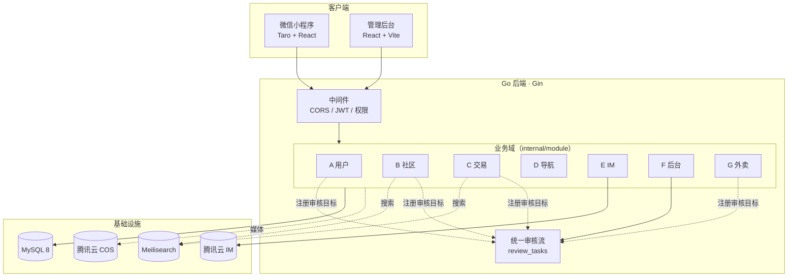

# 湛科生活圈 · Campus Circle

> 面向高校的一站式校园服务平台。社区、二手交易、校园导航、即时通讯、外卖配送与管理后台，统一在一套域边界清晰的架构下运行。

**Go 1.25** · **Gin** · **Gorm** · **MySQL 8** · **Meilisearch** · **Taro 4 + React 18**（小程序） · **React 18 + Vite**（后台） · **Docker** · **腾讯云 COS / IM**

---

## 项目概览

| 项 | 数值 |
| --- | --- |
| 后端代码 | **约 8.4 万行 Go**（441 个文件） |
| 前端代码 | 约 4,900 行（小程序 + 后台，125 个文件） |
| 业务域 | **7 个**，边界由自动化脚本强制 |
| 数据库迁移 | 37 个，每个附回滚脚本与迁移测试 |
| 端 | 微信小程序（用户/商家/骑手）+ Web 管理后台 |

> 📷 **截图占位**：首页信息流 / 二手商品详情 / 外卖下单 / 骑手抢单台 / 后台统一审核台
> *（面试前请补上 3~5 张真实截图，这是评审最先看的部分）*

## 功能一览

| 域 | 能力 |
| --- | --- |
| **A 用户** | 微信登录、JWT、用户资料、权限中间件（多角色：学生 / 商家 / 骑手 / 管理员） |
| **B 社区** | 帖子、多图、评论、点赞、收藏、Feed 流、全文搜索 |
| **C 交易** | 二手商品发布、图片、搜索、收藏、**商品状态机**、联系卖家 |
| **D 导航** | 校园服务分类与导航项，只保存 `appid + path` 跳转数据 |
| **E IM** | 对接腾讯云 IM，**只保存用户映射与会话关系，不保存消息** |
| **F 后台** | 用户 / 帖子 / 商品 / 举报管理、统计、**统一审核流** |
| **G 外卖** | 商家入驻、菜品、订单、支付、**配送抢单**（骑手端） |

---

## 技术架构



**分层职责**：handler 只做输入输出 → service 承载状态机、权限与审核规则 → repository 独占数据访问。

---

## 技术难点与设计决策

### 1️⃣ 用自动化脚本把架构规则变成 CI 门禁

架构约定最容易在项目变大后失效——文档写着"不许跨域访问"，实际代码里到处都是。

项目用 [`scripts/check-boundaries.cjs`](scripts/check-boundaries.cjs) 静态扫描 Go 源码，**把每条架构规则变成会失败的检查**：

| 规则 | 检查方式 |
| --- | --- |
| 业务域必须登记 | `internal/module/` 下出现白名单外的目录 → 失败 |
| 数据库访问只能在仓储层 | 非 `*_repository.go` / `repository.go` 文件里出现 `*gorm.DB` 或 `.WithContext(` → 失败 |
| D 域不得依赖任何业务域 | 源码中出现 `internal/module/{user,community,...}` → 失败 |
| **E 域不得存储消息** | 源码中出现 `type Message` / `message_content` / `messages` → 失败 |
| G 域核心不得引入 HTTP 或其他业务域 | 同上模式 |
| 各传输适配器不得越域 | `admin/deliverymerchant` 等目录单独校验 |

`npm run verify` 会执行这套检查，**规则不通过就无法提交**。这让"域边界"从口头约定变成了可执行的约束。

### 2️⃣ 统一审核流 + 领域服务注册（依赖倒置）

平台上有六类内容需要审核：帖子、评论、商品、商家、菜品、举报。

如果让后台域直接改这些表，F 域会变成依赖所有业务域的中心节点——**改任何一域都要动后台**。

实际做法：所有内容创建时统一登记到 `review_tasks`，业务域通过 `RegisterTarget` **把自己的回写逻辑注册给审核流**。F 域只驱动状态流转，通过接口回调，**不直接访问业务表**。

```text
submitted → reviewing → approved（允许展示）
                     ↘ rejected（不展示）
```

同一套机制支撑六类内容，新增一类只需注册一个 target。社区 Feed 与商品列表只查询 `approved`。

### 3️⃣ 生产级数据库迁移

37 个迁移，每个都附带**回滚脚本**（`migrations/rollback/`）和**迁移测试**，`npm run verify` 校验三者一致。

关键迁移（如 [`037_report_idempotency.sql`](backend/migrations/037_report_idempotency.sql)）使用 MySQL 存储过程 + `GET_LOCK` 实现**迁移互斥**，并在 `EXIT HANDLER` 中释放锁——避免多实例并发执行迁移。

### 4️⃣ IM 不自建消息存储

即时通讯自研成本极高（消息序、离线补偿、多端同步）。项目选择只保存**用户映射与会话关系**，消息本体交给腾讯云 IM。

C 域（联系卖家）与 G 域（买家↔商家/骑手）都通过 E 域暴露的 `ConversationGateway` 建立会话，**不各自造一套消息系统**。上面第 1 条的脚本会用静态检查守住这条边界。

### 5️⃣ 生产环境拒绝不可追溯的构建

`deploy` 通过 `-ldflags` 注入 `buildVersion` / `buildCommit` / `buildTime`。当 `APP_ENV=prod` 时，若版本为 `dev`、提交号非法或标记为 `-dirty`，**服务直接拒绝启动**。

避免"线上跑的到底是哪个版本"这类事故。

### 6️⃣ 媒体资源引用与可见性门禁

媒体资源不直接在业务表里存 URL，而是通过 `media_asset_references` 引用。对外展示统一经过 MediaGateway，**只放行 `final + approved` 状态的资源**——未审核完成的图片不会泄漏到前台。

---

## 工程实践

| 实践 | 说明 |
| --- | --- |
| **域边界自动化** | 架构规则由脚本强制，进 CI |
| **契约检查** | 20+ 个 `check:*` 脚本校验小程序页面、后台 UI、身份契约、发布流程等 |
| **统一校验入口** | `npm run verify` 串联边界、契约、类型检查与后端测试 |
| **迁移可回滚** | 每个迁移都有 rollback 与测试 |
| **多端一致** | 小程序与后台共享 TS 类型契约 |
| **原生部署可校验** | `check:native-deployment` 校验 systemd 单元与构建参数 |

`npm run verify` 覆盖：

```text
域边界 · 小程序静态路由 · 业务闭环 · 无假页面 · 二次编辑契约
身份应用契约 · 商家/骑手工作台 · 主页真实工具 · 发布契约
原生部署 · 微信密钥卫生 · TypeScript 类型检查 · 后端测试
```

---

## 目录结构

```text
apps/
  miniapp/        微信小程序（Taro 4 + React 18 + Zustand + 腾讯云 IM SDK）
  admin/          管理后台（React 18 + Vite + TypeScript）
backend/
  cmd/            可执行入口：server、admin-credential、audit-mock-users、cos-review-probe
  internal/       业务代码
    module/       按业务域划分（user / community / trade / navigation / im / admin / takeout / delivery / media ...）
    middleware/   CORS、认证、权限
    pkg/          通用工具与响应协议
  migrations/     SQL 迁移 + rollback/
deploy/
  docker-compose.yml   本地与演示栈
  nginx/               反向代理
  native/              systemd 单元与生产 Nginx 配置
docs/             架构（ARCHITECTURE.md）、ADR、验收报告、运维手册
scripts/          开发、校验、演示脚本
```

---

## 快速开始

```powershell
npm install
Copy-Item .env.example .env

npm run dev:infra      # MySQL(3307) 与 Meilisearch
npm run db:seed        # 初始化数据
npm run dev:backend    # http://127.0.0.1:8080

npm run dev:admin      # 管理后台 http://127.0.0.1:5173
npm run dev:miniapp    # 小程序监听构建，产物在 apps/miniapp/dist
```

小程序产物用**微信开发者工具**打开 `apps/miniapp/dist` 预览。

一次性拉起完整容器栈：

```powershell
npm run dev:stack
```

容器端口：后端 `8080`、管理后台 `8088`、MySQL `3307`。

> 完整栈要求 `.env` 中已填好 compose 声明的必填变量（`MEILI_MASTER_KEY`、`COS_SECRET_ID`、`COS_SECRET_KEY` 等）。

## 环境要求

| 依赖 | 版本 |
| --- | --- |
| Go | 1.25+ |
| Node.js | `^20.19.0` 或 `>=22.12.0` |
| Docker Desktop | MySQL 与 Meilisearch |
| 微信开发者工具 | 调试小程序 |

## 接口概览

服务默认监听 `http://127.0.0.1:8080`，业务接口前缀 `/api/v1`。

| 路径 | 说明 |
| --- | --- |
| `GET /healthz` · `GET /readyz` · `GET /version` | 存活 / 就绪 / 版本（含提交号与构建时间） |
| `/api/v1/auth` · `/api/v1/admin-auth` | 用户端与管理端登录 |
| `/api/v1/community` | 社区：帖子、评论、Feed、搜索 |
| `/api/v1/trade` | 二手交易：商品、评论、搜索 |
| `/api/v1/navigation` | 校园导航 |
| `/api/v1/im` | 会话关系与用户映射 |
| `/api/v1/admin` | 后台管理与统一审核流 |
| `/api/v1/media` · `/api/v1/miniapp/media` | 媒体资源与微信回调 |

## 部署

- **容器**：`deploy/docker-compose.yml` + `deploy/nginx/`
- **原生**：`deploy/native/` 提供 systemd 单元（API、Meilisearch）、日志格式与生产 Nginx 站点配置

## 配置与安全

- `.env` 不入库（`.gitignore` 忽略 `.env` 与 `.env.*`，仅保留 `**/.env.example`）
- 生产环境必须为 `JWT_SECRET`、`MEILI_MASTER_KEY`、`WECHAT_CALLBACK_TOKEN` 设置随机值
- `COS_*`、`TENCENT_IM_*`、`WECHAT_PAY_*` 凭据只在部署环境注入
- `ALLOW_MOCK_WECHAT_LOGIN`、`ALLOW_MOCK_PAYMENT` 严禁在生产开启
- `CORS_ALLOW_ORIGINS` 只填写可信来源

## 文档

| 文档 | 内容 |
| --- | --- |
| [docs/ARCHITECTURE.md](docs/ARCHITECTURE.md) | 域边界、代码归属与依赖规则 |
| [docs/DEVELOPMENT.md](docs/DEVELOPMENT.md) · [DEVELOPMENT_DISCIPLINE.md](docs/DEVELOPMENT_DISCIPLINE.md) | 开发流程与纪律 |
| [docs/adr/](docs/adr/) | 架构决策记录 |
| [docs/evidence/](docs/evidence/) | 验收证据 |
| [docs/runbooks/](docs/runbooks/) | 运维手册 |
