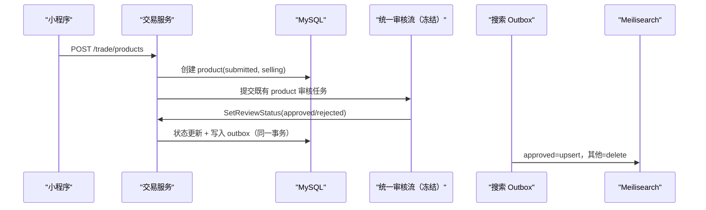
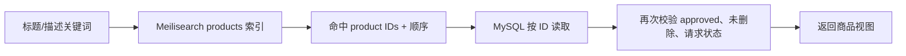
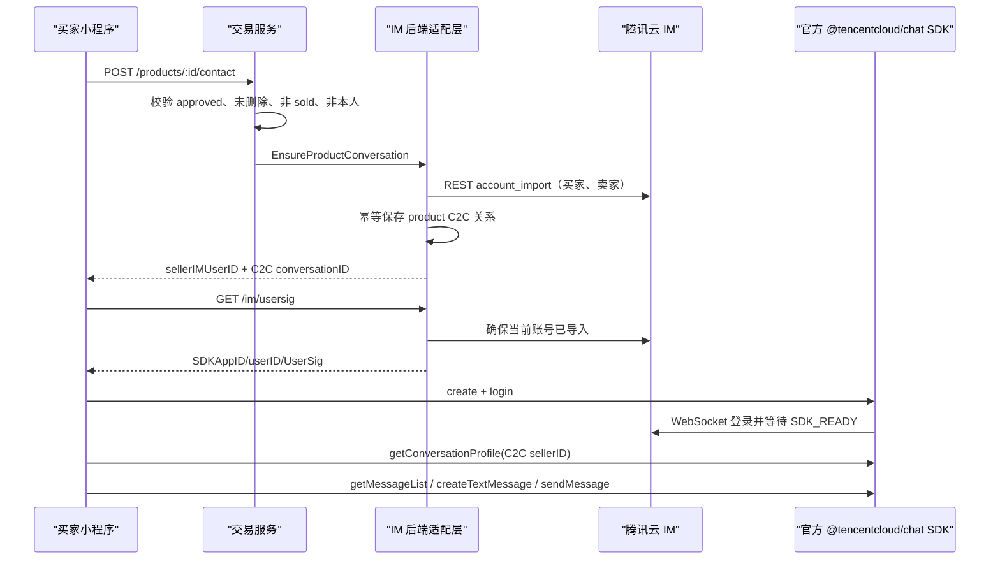
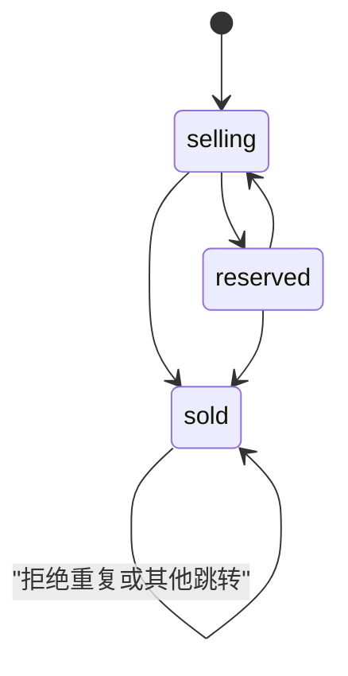

# P0-3 Transaction Closure Design

版本：1.0  
日期：2026-06-18  
范围：交易域 C 与腾讯云 IM 适配域 E  
冻结边界：不修改 P0-1 权限体系、P0-2 社区闭环、统一审核流；不推进 COS 或运维专项

## 1. 目标与非目标

形成可验证的最小交易闭环：

`商品发布 → 统一审核 → 浏览/全文搜索 → 收藏 → 联系卖家 → 腾讯云 IM C2C 会话 → 预定/恢复出售/售出 → 售出展示`

本阶段不实现支付、订单、物流、担保交易、自建消息存储、图片上传或图片审核。后端不得保存腾讯云 IM 消息内容。

## 2. 当前基线与缺口

| 项目 | 当前真实状态 | 设计结论 |
| --- | --- | --- |
| 商品搜索 | MySQL `title LIKE OR description LIKE` | 替换为真实 Meilisearch 全文检索 |
| 搜索同步 | 无索引、无同步机制 | 使用交易域 outbox，数据库为事实源 |
| 商品收藏 | 复合主键关联用户，但并发先查后插 | 改为幂等插入，仅真实变更时更新计数 |
| 腾讯 IM | UserSig + 本地伪 conversation ID | 接入官方 JS SDK；后端导入账号并只保存关系 |
| 会话页面 | 不存在，仅 toast | 增加真实 C2C 消息页，SDK 拉取/发送消息 |
| 状态机 | service 内判断，数据库无 CAS | 改为带旧状态条件的原子更新 |
| 售出展示 | 默认列表过滤 selling，无卖家入口 | 支持状态筛选、售出标签、卖家状态操作 |
| 删除/编辑/审核同步 | 不同步搜索 | 全部写入 outbox，异步收敛 |

## 3. 数据流

### 3.1 发布与审核



统一审核流的状态和调用方式不做修改。交易域只在既有 `SetReviewStatus` 边界内原子更新商品审核状态并登记索引事件。

### 3.2 搜索



Meilisearch 是检索引擎，不是权限和展示事实源。即使索引短暂滞后，MySQL 二次校验也不能暴露未审核、删除或状态不匹配商品。

无关键词的普通浏览继续由 MySQL 承担；有关键词时必须经过 Meilisearch，不允许静默退回 `%LIKE%` 伪装搜索成功。搜索不可用返回 503。

### 3.3 联系卖家与腾讯云 IM



真实腾讯会话 ID 使用官方规则 `C2C${sellerIMUserID}`。本地 `im_conversations` 只记录商品、买卖双方和该真实 C2C ID，不保存消息。

## 4. 状态机设计

状态含义：

- `selling`：出售中，可以被搜索、收藏和联系；
- `reserved`：已预定，仍可展示和保留既有会话，可恢复出售或售出；
- `sold`：已售出终态，继续公开展示并标记“已售出”，禁止新收藏和新建联系关系。

允许流转：



约束：

1. 只有 seller 可修改；
2. 商品必须为 approved 且未删除；
3. 数据库使用 `WHERE id=? AND seller_id=? AND status=?` 的 CAS 更新；
4. 并发状态更新只有一个成功，另一个返回冲突；
5. sold 是终态；
6. 编辑已售出商品、删除已售出商品、联系已售出商品和收藏已售出商品均拒绝；
7. 状态成功变化后写入搜索 outbox；sold 保留索引，供售出筛选与详情展示。

## 5. 搜索架构

### 5.1 索引文档

索引名：`products`

```text
id, title, description, category, campus, condition,
status, reviewStatus, sellerId, price, favoriteCount,
createdAt, updatedAt
```

- searchable：`title`, `description`
- filterable：`status`, `reviewStatus`, `category`, `campus`, `sellerId`
- sortable：`createdAt`, `updatedAt`, `price`, `favoriteCount`
- 主键：`id`

### 5.2 Outbox

表：`trade_search_outbox`

- 唯一事件主键；
- `product_id`、`operation(upsert/delete)`；
- `attempts`、`available_at`、`processed_at`、`last_error`；
- `(processed_at, available_at, id)` 索引。

商品审核、编辑、删除和状态变化与 outbox 事件在同一 MySQL 事务提交。worker 失败后指数退避重试；处理为幂等 upsert/delete。启动时先配置索引，再持续消费。

### 5.3 同步规则

| 事件 | 索引动作 |
| --- | --- |
| 新商品 submitted | delete/no-op |
| 审核 approved | upsert |
| 审核 rejected/reviewing/submitted | delete |
| 编辑并重新 submitted | delete |
| selling ↔ reserved | upsert |
| selling/reserved → sold | upsert |
| 软删除 | delete |

## 6. 腾讯云 IM 架构

- 小程序使用官方 `@tencentcloud/chat`，仅实现文本 C2C；不安装上传插件，避免越界进入 P0-4。
- UserSig 仅由后端生成，Secret 永不进入前端。
- 后端使用腾讯云 REST `account_import` 保证买卖双方账号存在。
- IM UserID 使用稳定前缀 `campus_<userID>`，避免裸数据库 ID 与其他业务账号冲突。
- `TENCENT_IM_SDK_APP_ID`、`TENCENT_IM_SECRET_KEY`、`TENCENT_IM_ADMIN_USER` 在生产必须配置；缺失时拒绝启动。
- 前端等待 `SDK_READY` 后才能获取会话和发送。
- 消息历史、未读数和消息内容全部由腾讯云 SDK/服务维护；本系统数据库无 message 表。
- 当前商品关系作为页面上下文展示，不向消息内容自动写入系统占位消息。

## 7. 接口清单

### 7.1 交易域

| 方法 | 路径 | 说明 |
| --- | --- | --- |
| GET | `/trade/products` | 浏览；支持 `keyword/category/status/page/pageSize` |
| GET | `/trade/products/:id` | approved 商品详情，包含 sold |
| GET | `/trade/my-products` | 当前卖家全部商品及状态 |
| POST | `/trade/products` | 发布并进入既有审核流 |
| PUT | `/trade/products/:id` | seller 编辑；重新 submitted 并删除索引 |
| DELETE | `/trade/products/:id` | seller 软删除并删除索引 |
| PATCH | `/trade/products/:id/status` | seller 原子状态流转 |
| POST | `/trade/products/:id/favorite` | 用户收藏；sold 禁止新增 |
| POST | `/trade/products/:id/contact` | 返回真实腾讯 C2C 会话上下文 |

### 7.2 IM 域

| 方法 | 路径 | 说明 |
| --- | --- | --- |
| GET | `/im/usersig` | 当前用户 SDKAppID/UserID/UserSig |
| GET | `/im/conversations` | 本人有权访问的商品会话关系 |

消息拉取和发送不经过后端 API，直接使用腾讯官方 SDK。

## 8. 验收标准

1. 代码库存在真实 Meilisearch 客户端、索引设置、查询和 outbox worker；关键词搜索不再执行 SQL `%LIKE%`；
2. 标题和描述均可命中，结果经 MySQL 二次校验；
3. 收藏关系使用 `(product_id,user_id)`，并发切换不产生重复关系或计数漂移；
4. 小程序真实调用 `@tencentcloud/chat` 登录、等待 ready、进入 `C2C...` 会话、拉取和发送文本；
5. 腾讯 REST 账号导入成功后才创建本地关系；不存在 mock IM 分支、toast 伪会话或本地消息表；
6. 状态机所有允许/禁止路径有测试，更新使用 CAS；
7. selling/reserved/sold 均能按状态展示；sold 详情有明确标签，禁止新联系与新增收藏；
8. 审核流代码不变，product 审核状态变化能驱动索引；
9. 编辑、删除、审核和状态变化均产生正确索引事件；
10. `npm run verify`、`go vet ./...`、生产构建和专项测试通过；
11. 使用真实 Meilisearch 与腾讯云测试应用完成预发布 E2E 后，才能将“外部服务真实闭环”判为最终通过。

## 9. 官方实现依据

- 腾讯云 Chat JS SDK：NPM 包 `@tencentcloud/chat`，小程序与 Web 使用同一 SDK；登录后需等待 `SDK_READY`。
- 腾讯云 C2C 会话 ID：`C2C${userID}`。
- 腾讯云服务端账号导入：REST `account_import`。
- Meilisearch：文档批量增删、filter、searchable/filterable/sortable attributes 和 Docker 部署。

