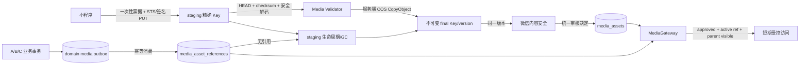

# P0-4 Architecture Review Report

版本：v1.0
审查日期：2026-06-20
审查对象：[P0-4 Media Pipeline Design v1.0](./P0-4_MEDIA_PIPELINE_DESIGN_v1.0.md)
审查角色：高级架构与安全评审
审查阶段：设计审查，禁止实施
最终结论：**NO-GO / FAIL，存在 3 项 P0 阻断风险，禁止进入 P0-4 开发阶段**

## 1. 执行摘要

设计的总体方向正确：私有 COS、前端直传、精确对象 Key、短期 STS、后端实物校验、统一审核流、MediaGateway、状态审计和异步回收均符合媒体链路的基本架构原则。

但当前版本尚不能判定 PASS。发现三个 P0 级问题：

1. **上传凭证在 complete/审核后仍可覆盖同一对象 Key**。客户端可在后端完成校验甚至审核通过后，使用尚未过期的 PutObject 权限替换 COS 对象，形成“审核的是 A，展示的是 B”的 TOCTOU 漏洞。
2. **10 MiB/5 MiB 限制只在上传后校验，未证明 COS 在请求入口拒绝超大对象**。攻击者在 10 分钟内可向精确 Key 反复上传超大对象；即使最终删除，上传、存储和请求成本已经发生。
3. **帖子/商品/头像生命周期与媒体引用解除没有可靠的事务事件保证**。业务删除成功而 `DeleteReference` 失败时，可能同时产生残留公开访问、错误引用计数和永久孤儿对象。

因此，本报告不授权修改迁移、后端媒体代码、小程序上传代码或部署配置。完成第 8 节的设计整改并重新评审为 PASS 后，方可进入开发。

## 2. 审查范围与判级

本次只审查设计，不审查或认可现有草稿实现，不修改 P0-1/P0-2/P0-3、统一审核流或 P0-5。

判级规则：

- **P0 / 高风险**：可导致未审核内容公开、越权写入、不可控成本攻击或核心一致性失效；阻断开发。
- **P1 / 中风险**：不会直接突破首要安全门禁，但可造成数据漂移、长期存储泄漏、恢复困难或显著成本风险；进入开发前应写入设计并形成验收项。
- **P2 / 低风险**：可运营或可维护性问题；不得遗忘，但不单独阻断开发。

## 3. 十二项重点审查结论

| # | 审查项 | 当前结论 | 风险级别 | 摘要 |
| --- | --- | --- | --- | --- |
| 1 | COS STS 是否越权 | 部分合格 | **P0** | 精确 Key 防横向越权，但凭证可在审核后覆盖同一 Key |
| 2 | 上传到他人目录 | 基本合格 | P1 | 服务端 Key + 精确资源可阻断；需真实策略负向测试和刷新接口状态约束 |
| 3 | 图片关联与孤儿 | 不合格 | **P0** | Reserve/Commit 仍有双写窗口，父对象删除缺少事务 outbox |
| 4 | 审核失败占用 COS | 部分合格 | P1 | 有 GC 方向，但缺少明确截止时间、最大重试和兜底生命周期 |
| 5 | 帖子/商品删除、头像更新垃圾 | 不合格 | **P0** | DeleteReference 为跨域调用，失败时没有可靠事件补偿 |
| 6 | 内容审核与业务审核一致性 | 部分合格 | P1 | 双门禁正确，但状态主从、迟到回调和父对象可见性投影未定义 |
| 7 | 高并发 DB/COS 一致性 | 部分合格 | P1 | CAS/幂等方向正确，仍缺对象不可变和 durable outbox |
| 8 | 重复上传浪费 | 部分合格 | P1 | 当前只解决重复请求，不解决同用户重复内容及幂等键冲突 |
| 9 | 超大/异常/MIME 伪造 | 不合格 | **P0/P1** | 超大对象为 P0；512 字节 Range 与未定尺寸阈值不足为 P1 |
| 10 | COS 最小权限 | 基本合格 | P1 | PutObject 精确 Key 正确；CORS、刷新、最终对象写权限仍需收口 |
| 11 | 引用计数与回收 | 不合格 | P1 | 单字段引用与“引用计数”语义冲突，缺标准化引用表或单引用硬约束 |
| 12 | 2 万用户成本 | 不完整 | P1 | 存储估算合理，但遗漏图片浏览下行流量这一主成本项 |

## 4. P0 高风险问题

### P0-01：审核后对象可被临时凭证覆盖

**现状**

设计给客户端 10 分钟、精确 Key 的 `PutObject` 权限。后端通过 HEAD/Range 校验该 Key 后开始审核，并最终按同一 Key 展示。

**攻击路径**

1. 客户端上传合法图片 A；
2. 调用 complete，后端校验 A；
3. 微信审核 A 通过；
4. 原 STS 尚未过期，客户端再次 PutObject，将同一 Key 覆盖成未审核图片 B；
5. MediaGateway 仍认为资产 approved，公开端点展示 B。

精确 Key 只防止写到其他对象，不能保证该对象在校验后不可变。STS 已签发后也不能依赖应用数据库状态即时撤销。

**影响**

- 绕过微信内容安全审核；
- 未审核或恶意内容公开；
- 数据库 verified_size/MIME/hash 与 COS 实物不一致；
- 审计证据指向被替换前的内容。

**必须整改**

采用“临时上传 Key + 不可变最终 Key”两段式对象模型：

```text
客户端可写：staging/<env>/<owner>/<asset>/<nonce>.<ext>
后台可写：media/<env>/<purpose>/<yyyy>/<mm>/<asset>/<digest>.<ext>
```

流程：

1. STS 只允许写精确 staging Key；
2. complete 校验 staging 对象并记录 ETag、校验和、长度和版本信息；
3. 后端使用服务角色执行 COS 服务端 CopyObject 到 final Key，不经应用传输图片字节；
4. final Key 从未授予客户端 PutObject；
5. 微信审核和公开访问只指向 final Key；
6. staging 对象立即进入删除队列，并配置短期生命周期兜底；
7. credentials 刷新只允许 `pending_upload`，complete 后永久拒绝刷新。

若不采用服务端 CopyObject，替代方案必须使用 COS 版本控制并把 `versionId` 固定到审核、数据库和公开 GET 全链路；只记录 ETag 而仍访问“当前版本”不能解决问题。

**关闭标准**

- approved 后使用原 STS 再次上传，不改变公开展示对象；
- 客户端无法写 final Key；
- 微信审核 URL 与公开访问 URL 指向同一不可变对象版本；
- 真实 COS 集成测试证明上述结论。

### P0-02：超大文件只做事后校验，存在成本攻击窗口

**现状**

设计在申请时校验客户端声明，在 complete 时通过 HEAD 校验真实大小。但持有临时密钥的客户端可以自己签名 PutObject 请求，声明值并不能证明实际上传值。

**影响**

- 单个凭证可在有效期内反复覆盖并上传超大对象；
- 上传流量、请求和短期存储成本已发生，事后删除不能撤销成本；
- GC 处理积压，攻击者可用大量 pending 资产消耗预算。

**必须整改**

1. 禁止 multipart 相关权限，只允许单次 PutObject；
2. 必须在真实 COS 环境证明上传请求入口可按受信条件拒绝超限 Content-Length；
3. 若 STS/CAM policy 无法可靠约束上传长度，则改为后端签发精确 Key、精确 Content-Length、Content-MD5 的短期单次预签名 PUT，或使用具备硬容量预算的独立 staging Bucket；仍保持客户端直传，禁止后端中转字节；
4. staging Bucket/前缀配置 1 天以内生命周期兜底和独立预算上限；
5. STS/预签名票据必须是一次性业务票据：创建、刷新次数、pending 数、小时/日字节配额均原子扣减；
6. complete 发现超限时立即逻辑拒绝并优先删除，不等待普通 GC 批次。

**关闭标准**

- 真实 COS 上传 10 MiB + 1 字节（头像为 5 MiB + 1 字节）在对象完整落桶前被拒绝，或被隔离在有硬预算的 staging 区；
- 客户端无法启用 multipart 绕过；
- 并发 100 次超限请求不能突破用户字节配额；
- 验收证据包含脱敏 policy、请求和 COS 对象列表。

### P0-03：父业务对象删除与媒体引用解除不是可靠事务

**现状**

设计描述业务写入后调用 Commit，删除/拒绝/替换后调用 DeleteReference；但 A/B/C 与媒体域禁止跨表事务，且没有定义业务域可靠 outbox。若业务事务成功、MediaGateway 调用失败，引用状态不会自动收敛。

**典型失败**

- 帖子已软删除，媒体引用仍 active，旧访问地址继续可用；
- 商品已删除，COS 对象和引用长期残留；
- 新头像已写入，旧头像 DeleteReference 失败，产生垃圾对象；
- 业务创建成功但 Commit 失败，24 小时孤儿任务可能误删仍在业务表引用的图片。

**必须整改**

为每个接入域定义“业务事务内 outbox + 媒体域幂等消费”协议：

1. 业务对象创建/更新/删除与 `media_reference_requested` 事件写入同一业务事务；
2. 事件包含 operationId、referenceType、referenceId、assetIds、目标可见状态和版本号；
3. 媒体消费者按 operationId 幂等激活、替换或撤销引用；
4. MediaGateway 的公开访问只认 active 引用和父对象可见性投影；
5. 业务删除事务提交后，外部响应不得继续返回旧媒体访问对象；
6. 对账任务通过各域公开事件/查询契约校验，禁止媒体仓储直接查询 A/B/C 表；
7. 24 小时孤儿删除前必须确认没有 pending outbox 或未完成 reservation，不能只看 `reference_id IS NULL`。

这属于 P0-4 接入钩子，不得改变社区或交易业务规则、状态机、搜索、权限或审核语义。

**关闭标准**

- 模拟 Commit/DeleteReference 连续失败，恢复后引用最终正确；
- 业务创建成功但消费延迟时资产不被孤儿任务误删；
- 帖子/商品删除和头像替换均有故障注入测试；
- outbox 重复、乱序、延迟消费不导致引用计数漂移。

## 5. P1 中风险问题

### P1-01：媒体状态与统一审核状态存在双重事实源

设计同时维护 `review_tasks` 状态和 `media_assets.status`，但没有明确哪个是事实源，也没有定义写一半失败、迟到回调和人工复核的收敛规则。

整改建议：

- 统一审核任务是审核结论事实源，媒体状态是可重建投影；
- 使用 `review_task_id + decision_version` 更新媒体投影；
- 可见条件固定为：

```text
media=approved
AND reference=active
AND parent_visibility=approved/visible
AND delete_requested_at IS NULL
AND final_object_version 已固定
```

- 明确 late callback：旧 decision_version 一律忽略；
- 明确父对象拒绝不回退媒体审核结论，只撤销引用并回收；
- 明确媒体被重新判定风险时，先停止访问，再通过既有审核服务处理，不直接跨域修改父对象。

### P1-02：审核失败和卡死状态缺少可执行的 GC 截止时间

“长时间无法完成且达到确定性失败门禁”没有具体定义，可能导致 uploaded/submitted/reviewing 永久占用 COS。

整改建议在设计中固化：

| 状态 | 建议截止时间 | 到期动作 |
| --- | --- | --- |
| pending_upload | 30 分钟 | delete_pending |
| uploaded 未提交审核 | 1 小时 | 重试；超最大次数后 rejected/delete_pending |
| submitted | 1 小时 | 重投/恢复任务 |
| reviewing | 24 小时 | 查询/补偿；超策略后 fail-closed 并进入人工/拒绝路径 |
| rejected | 立即停止访问，1 小时内请求删除 | delete_pending |
| approved 未绑定 | 24 小时 | 确认无 outbox/reservation 后删除 |
| delete_pending | 指数退避，最大重试后进入 dead-letter | 保持不可访问 |

dead-letter 的业务状态属于 P0-4；其监控告警属于 P0-5，本阶段不启动。

### P1-03：引用模型与引用计数语义冲突

`media_assets` 内嵌单个 `reference_type/reference_id/reference_sort`，同时需求要求引用计数和重复上传治理。当前模型既不能可靠表达多引用，也没有明确强制“每个资产只能被一个业务位置引用”。

必须二选一：

1. **MVP 单引用模型**：数据库唯一约束保证每个 asset 最多一个 active reference，`ref_count` 只能为 0/1；禁止把同一 assetId 用于多个对象；逻辑最简单但会增加同内容重复存储。
2. **标准化多引用模型**：新增 `media_asset_references`，以引用行作为事实源，`active_ref_count` 只作可重建缓存；唯一约束 `(reference_type, reference_id, slot)` 和 `(asset_id, reference_type, reference_id, slot)`。

评审建议采用标准化引用表，避免以后为复用、替换、顺序和回收再次迁移。物理删除条件必须是：无 active/pending 引用、无有效 reservation、无未消费 outbox，且达到保留期限。

### P1-04：文件真实性校验不足

前 512 字节足以识别基础魔数，但不保证能读取所有 JPEG 尺寸信息，也不能证明文件完整可解码。合法图片头后附恶意内容的 polyglot 文件仍可能通过。

整改建议：

- 上传必须携带 Content-MD5，COS 校验后记录 ETag/CRC64/版本；
- 使用受限解码器或 COS 图片信息能力读取真实 width/height/format，设置 CPU、内存和像素上限；
- 只允许 JPEG/PNG/WebP 的安全子集；拒绝动画 WebP；
- 返回 `Content-Type` 必须使用 verified_mime，增加 `X-Content-Type-Options: nosniff`；
- 不信任扩展名、客户端 Content-Type 或客户端 SHA-256；
- 将像素阈值从“建议值”改为强制值，并通过畸形/截断/解码炸弹样本验收。

### P1-05：幂等键与内容去重混用

`purpose + 本地 SHA-256 + size` 同时承担请求幂等和内容去重，但客户端哈希不可信；同一幂等键配不同内容时的行为未定义。

整改建议：

- 请求幂等键由一次用户操作生成，与内容哈希分离；
- 相同幂等键但 purpose/size/MIME/hash 声明不同返回 409；
- 同用户内容去重只在服务端确认受信校验和后执行；
- 不做跨用户去重；
- 已绑定资产是否允许复用必须与第 P1-03 的引用模型一致。

### P1-06：CORS、签名 URL 和删除后的残留访问窗口未定义

设计采用 5 分钟签名 GET。删除请求登记后，已经签发的 URL 仍可能继续访问至过期；同时未定义 COS CORS 最小策略。

整改建议：

- 上传 CORS 仅允许批准的小程序来源/域名、PUT、必要请求头；禁止 `*`；
- STS 不授予 GET，公开访问只通过 MediaGateway；
- final Key 签名 URL 缩短至可接受的最小值，并明确“撤销最长延迟”；
- 对高敏撤销要求即时生效时，不得依赖已签发 URL，应使用受控 CDN 鉴权或后端流式代理；这需要单独容量评审，不在当前设计中默认引入；
- 签名 URL 不写业务表、不写日志、不进入长期缓存。

### P1-07：用户配额没有原子实现策略

“每分钟/小时/日/pending”阈值已列出，但没有指定并发下如何原子扣减。先查询再签发会被并发绕过。

整改建议：

- 定义单一 quota service，使用 Redis Lua 或数据库条件更新原子扣减“次数 + 声明字节数 + pending 数”；
- STS 签发成功才确认配额，失败可回滚或短期保留；
- complete/删除按状态幂等释放 pending；
- 小时/日配额按用户和 purpose 分桶；
- 配额记录与票据 ID 绑定，避免重试重复扣减或重复释放。

### P1-08：credentials 刷新接口缺少完整状态约束

刷新接口只描述“同资产、精确 Key”，未明确禁止 approved/rejected/delete_pending/deleted 状态刷新。

整改建议：只有 owner 且状态为 pending_upload、票据未取消、配额有效时可刷新；刷新只针对 staging Key；达到刷新次数或 upload deadline 后必须新建资产。

### P1-09：2 万用户成本模型低估下行流量

设计只估算上传和存储。按 2 万用户、平均 1 MiB/张：

| 场景 | DAU | 每活跃用户每日图片浏览 | 月图片 GET | 月下行量 |
| --- | ---: | ---: | ---: | ---: |
| 保守 | 10% | 20 | 120 万 | 约 1.14 TiB |
| 基准 | 20% | 50 | 600 万 | 约 5.72 TiB |
| 压力 | 30% | 100 | 1800 万 | 约 17.17 TiB |

相比之下，2 万用户每月上传 6 万张仅新增约 58.6 GiB，12 个月约 703 GiB。**浏览流量而非存储是主要成本项**。

整改建议：

- 成本预算必须同时代入存储、PUT/HEAD/Range/Delete、微信审核、签名接口、图片 GET 和下行流量单价；
- 客户端本地压缩目标应从“最长边建议”升级为可验收的平均字节目标，例如 300–500 KiB；这不是服务端压缩服务；
- 在不启动 CDN 的前提下完成 2 万用户流量预算，超过预算则在后续独立评审 CDN；
- 预发布压测统计 P50/P95 图片大小、单 feed 图片数、签名 QPS 和缓存命中率。

## 6. P2 低风险问题

| 编号 | 问题 | 建议 |
| --- | --- | --- |
| P2-01 | `public_id` 长度在 26/32 之间未定 | 固化一种编码、熵和大小写规则，避免多实现不一致 |
| P2-02 | owner-shard 规则未定义 | 固化不可逆分片算法；它只用于目录均衡，不能作为权限依据 |
| P2-03 | 历史 URL 只读兼容缺少退出条件 | 定义历史 URL 数量、迁移批次和最终禁用门禁 |
| P2-04 | 审计保留期限未定义 | 明确保留周期、敏感字段脱敏和清理策略 |
| P2-05 | Bucket 生命周期仅描述为“例如” | 明确只作用 staging 前缀，禁止规则覆盖 final 前缀 |
| P2-06 | signed GET 缓存语义不清 | 明确 Cache-Control、浏览器/CDN 缓存和撤销窗口 |

## 7. 推荐的修订后架构



修订后的关键不变量：

1. 客户端永远不能写 final Key；
2. 审核与展示使用同一不可变对象版本；
3. 超限对象在落桶前被拒绝，或只进入有硬预算的 staging 区；
4. 媒体公开可见性是审核投影、引用投影和父对象投影的交集；
5. 物理删除前必须证明无引用、无 reservation、无待消费 outbox；
6. 任何失败先停止访问，再异步收敛 COS；
7. 业务域通过事务 outbox 集成，不直接操作媒体表；
8. 所有凭证、回调、绑定和删除操作都有幂等 ID 与审计记录。

## 8. 进入开发前的强制整改清单

以下全部完成并重新评审为 PASS 前，禁止开发：

- [ ] 将 staging Key 与 final Key/版本分离，消除审核后覆盖漏洞；
- [ ] 证明上传入口的大小硬限制；无法证明时采用预签名 PUT 或独立硬预算 staging Bucket；
- [ ] 禁止 multipart 权限并增加 Content-MD5/受信校验和；
- [ ] 为 A/B/C 定义事务 outbox 和幂等引用消费协议；
- [ ] 决定单引用或标准化多引用模型，并定义权威引用计数；
- [ ] 固化审核状态事实源、decision_version 和可见性公式；
- [ ] 固化所有状态 TTL、最大重试、dead-letter 和 GC 优先级；
- [ ] 将文件尺寸、像素面积、动画 WebP 和安全解码从建议改为强制门禁；
- [ ] 固化 CORS、签名 URL TTL、删除后残留访问窗口；
- [ ] 定义原子限流/配额实现和并发验收；
- [ ] 补充 2 万用户下行流量预算和平均图片字节目标；
- [ ] 更新设计中的数据流图、状态图、数据库表和 API 验收矩阵。

## 9. 重新评审的 PASS 条件

重新评审只有同时满足以下条件才可判定 PASS：

1. P0-01、P0-02、P0-03 均有明确、可实现、可自动化验证的设计闭环；
2. 不以“开发后再验证”替代设计层面的安全不变量；
3. 不修改 P0-1/P0-2/P0-3 业务规则、权限、审核语义、状态机、搜索或 IM；
4. P1 项全部进入设计正文、数据库约束、接口契约或验收标准；
5. 真实 COS 策略负向测试被列为开发首个门禁，而不是上线前补测；
6. P0-5 仍未启动。

## 10. 最终判定

**P0-4 Architecture Review：NO-GO / FAIL。**

- 高风险：3 项 P0 阻断问题；
- 中风险：9 项；
- 低风险：6 项；
- 是否允许进入 P0-4 开发：**否**；
- 是否允许启动 P0-5：**否**；
- 下一步：只允许修订《P0-4 Media Pipeline Design v1.0》并重新提交架构评审。
