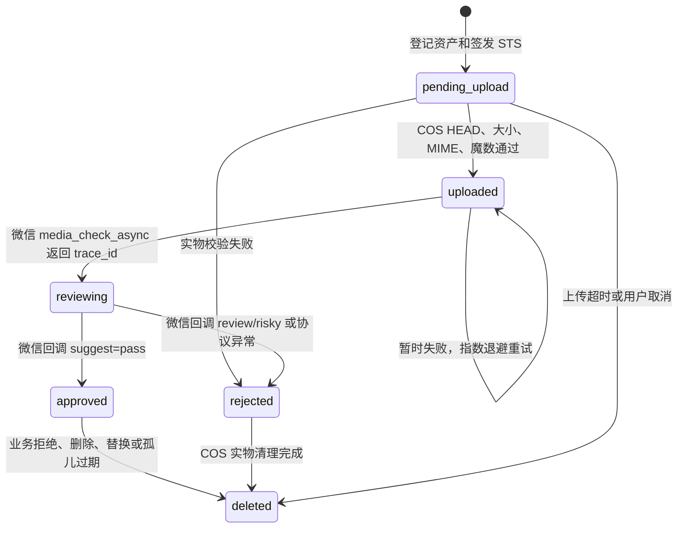
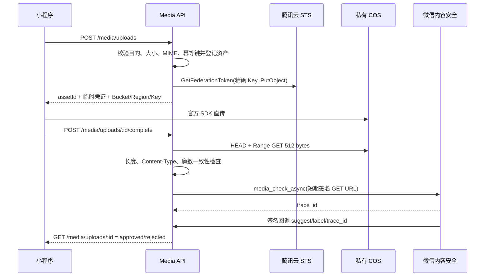

# P0-4 Media Pipeline Design

版本：1.0  
日期：2026-06-18  
范围：A 用户头像、B 社区帖子图片、C 商品图片的上传、审核、引用、访问与删除生命周期  
冻结边界：P0-3 交易状态机、搜索架构、腾讯云 IM 业务逻辑保持冻结；不进入 P0-5 监控、备份、告警或回滚专项

## 1. 设计目标

形成唯一允许的新图片路径：

`客户端选图 → 后端登记资产并签发短期 STS → 客户端直传私有 COS → 后端校验 COS 实物 → 微信内容安全异步审核 → 审核通过 → 绑定业务对象 → 受控展示 → 拒绝/替换/删除时清理 COS`

禁止继续接受任意外部 URL 作为新帖子图片、商品图片或用户头像。历史 URL 只保留读取兼容，不具备创建资格。

## 2. 模块边界

媒体能力位于 `backend/internal/pkg/media`，属于 A/B/C 共用的基础设施适配层，不新增第七业务域：

- A 用户域只绑定 `avatar` 目的资产。
- B 社区域只绑定 `post_image` 目的资产。
- C 交易域只绑定 `product_image` 目的资产。
- F 域既有文字审核流不被改写；图片审核由微信内容安全回调独立驱动。
- 各业务域仅依赖 `media.Gateway`，不得直接访问 `media_assets` 表或 COS SDK。
- P0-3 的搜索、状态机和 IM 文件不因图片链路改变行为。

## 3. 直传选择

采用客户端直传 COS，不采用服务端中转：

- 图片字节不经过业务 API，避免占用后端带宽、内存和连接池。
- 后端使用腾讯云 STS `GetFederationToken` 签发 10 分钟临时凭证。
- 每次凭证只允许 `PutObject` 到当前用户当前资产的精确随机对象 Key，不授予列桶、覆盖其他对象或删除权限。
- 客户端使用官方 `cos-wx-sdk-v5` 上传。
- COS 桶必须为私有读写；永久 SecretKey 只存在后端环境变量中。

## 4. 文件约束

| 目的 | 数量 | 单文件上限 | 类型 |
| --- | ---: | ---: | --- |
| 帖子图片 | 9 | 10 MiB | JPEG、PNG、WebP |
| 商品图片 | 9 | 10 MiB | JPEG、PNG、WebP |
| 用户头像 | 1 | 5 MiB | JPEG、PNG、WebP |

三层校验：

1. 客户端在申请上传前检查数量、扩展名和文件大小，仅用于用户体验。
2. 签发接口检查目的、声明 MIME、声明大小及幂等键。
3. 完成接口通过 COS HEAD 获取真实长度和 Content-Type，并读取对象前 512 字节用魔数重新识别 MIME；任一不一致立即拒绝并进入删除队列。

对象 Key 由服务端生成：`media/<purpose>/<user-id>/<yyyy-mm>/<asset-id>.<ext>`。不使用客户端文件名，防止路径穿越、覆盖和可预测枚举。

## 5. 数据结构

`media_assets`：

| 字段 | 含义 |
| --- | --- |
| `id` | 32 位随机资产 ID，主键 |
| `owner_user_id` | 上传者，所有操作均校验 |
| `purpose` | `post_image/product_image/avatar` |
| `object_key` | COS 唯一对象 Key |
| `declared_mime/verified_mime` | 声明与魔数验证类型 |
| `declared_size/verified_size` | 声明与 HEAD 实际大小 |
| `status` | `pending_upload/uploaded/reviewing/approved/rejected/deleted` |
| `review_trace_id` | 微信异步审核 trace，唯一 |
| `review_suggest/review_label` | 审核结论 |
| `reference_type/reference_id/reference_sort` | A/B/C 业务引用 |
| `reservation_token/reservation_expires_at` | 跨域创建前的短期占用 |
| `idempotency_key` | 同一用户重复申请去重 |
| `upload_expires_at` | 上传凭证/孤儿清理边界 |
| `review_attempts/review_available_at/last_error` | 审核提交重试 |
| `delete_requested_at/storage_deleted_at` | COS 清理收敛状态 |

关键约束：

- `object_key` 唯一。
- `(owner_user_id,idempotency_key)` 唯一。
- `review_trace_id` 唯一但允许空值。
- `(reference_type,reference_id,reference_sort)` 建普通查询索引；资产自身只能绑定一次。
- pending/review/delete 热点采用复合索引，worker 不扫全表。

## 6. 状态机

只有 `approved` 且未请求删除的资产可以预占、绑定和展示。审核中的图片绝不进入帖子、商品或头像字段。

## 7. 数据流

### 7.1 上传与审核

### 7.2 业务绑定

客户端提交 `imageAssetIds` 或 `avatarAssetId`，不提交图片 URL。

1. 业务服务调用 `Reserve`：锁定并验证 owner、purpose、approved、数量、未绑定，产生短期 reservation。
2. 业务表按返回的稳定地址创建/更新。
3. 业务服务调用 `Commit` 把 reservation 变为 `post/product/user` 引用。
4. 创建失败时 `Cancel`；reservation 到期也会自动回收。
5. 替换、删除或审核拒绝时调用 `DeleteReference`，只登记删除请求；worker 幂等删除 COS 后记账。

跨域数据库无法共享事务，因此采用 reservation + 幂等 Commit + 过期回收，而不是跨模块直接操作数据库。

## 8. 访问控制

- COS 禁止公共读。
- 业务表保存稳定 API 地址 `/api/v1/media/assets/:id/content`，不保存永久签名 URL。
- 内容端点只允许 `approved`、已绑定、未删除资产，随后 302 到 5 分钟 COS 签名 GET URL。
- 资产 ID 使用高熵随机值；未通过、未绑定、已拒绝或已删除统一返回 404，避免状态探测。
- 上传/完成/状态/取消接口必须 JWT 鉴权并校验 owner。
- 微信回调必须校验配置的 token 签名；trace_id 必须匹配现有 reviewing 资产。

## 9. 异常、并发和幂等

- 同一 `idempotencyKey` 并发申请只产生一个资产。
- `complete` 使用状态 CAS；重复调用返回当前状态，不重复提交审核。
- 微信重复回调按 trace_id 和终态幂等。
- STS 或微信暂时失败不伪造成功；上传状态保留并指数退避。
- COS 删除失败保留 `delete_requested_at`，worker 重试直至 `storage_deleted_at` 被记录。
- 用户取消、上传超时、审核拒绝和未绑定 approved 资产都会进入清理流程。
- 不做跨用户内容哈希去重，避免隐私侧信道；对象 Key 永不复用。

## 10. API 清单

| 方法 | 路径 | 鉴权 | 说明 |
| --- | --- | --- | --- |
| POST | `/api/v1/media/uploads` | 用户 | 登记资产并获取精确 Key STS |
| POST | `/api/v1/media/uploads/:id/complete` | owner | 校验 COS 实物并启动微信审核 |
| GET | `/api/v1/media/uploads/:id` | owner | 查询审核/清理状态 |
| DELETE | `/api/v1/media/uploads/:id` | owner、未绑定 | 取消并请求清理 |
| GET | `/api/v1/media/assets/:id/content` | 公开内容 | 仅 approved+bound 时签名跳转 |
| GET/POST | `/api/v1/media/wechat/callback` | 微信签名 | 验证配置、接收异步审核结果 |

业务接口媒体字段：

- `POST /community/posts`：`imageAssetIds`，最多 9。
- `POST/PUT /trade/products/:id?`：`imageAssetIds`，最多 9；仅改变图片输入，不改变 P0-3 状态规则。
- `PATCH /auth/me`：`avatarAssetId`，最多 1。

## 11. 验收标准

- 真实或协议级 STS 返回的 policy 仅含精确对象 PutObject 权限，永久密钥不下发。
- COS 真实对象的类型、大小和魔数三重一致后才进入审核。
- 标题声明伪造、超限、路径穿越、非图片、owner 越权均被拒绝。
- 微信 pass 才可展示；review/risky、错误回调或审核失败均不可展示。
- 20 路重复申请、完成和回调不产生重复资产、重复审核或状态回退。
- 帖子、商品和头像只能绑定当前用户对应 purpose 的 approved 资产。
- 拒绝、取消、替换、父对象拒绝/删除后 COS 删除请求可最终收敛。
- 全量 Go/TypeScript/边界测试和双端构建通过。
- 未提供真实 COS 或微信凭证时，报告必须明确标记相应云端验收未完成，不得以 Mock 判通过。

## 12. 成本控制原则

- 客户端直传避免后端流量双倍计费。
- 文件大小和数量在签发前限制，减少恶意存储。
- 私有桶签名 GET 缓存 5 分钟；不签发原图永久公开地址。
- 上传超时、拒绝和孤儿资产自动清理，避免长期存储泄漏。
- MVP 不引入缩略图、图片处理流水线或 CDN 新业务；相关优化只作为后续成本评估项。
