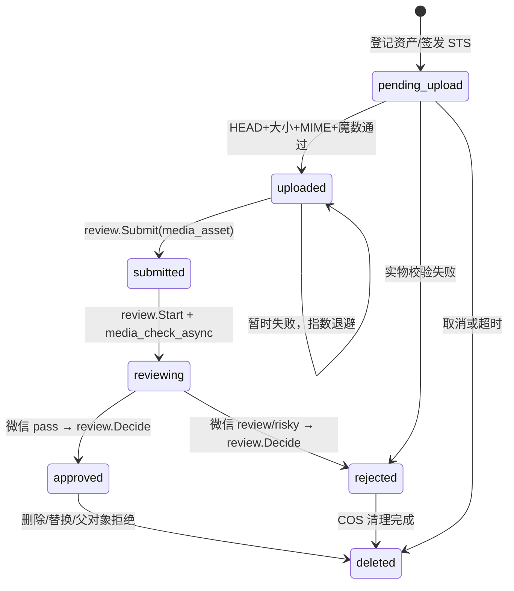

# P0-4 Media Pipeline Design v1.0

版本：1.0  
日期：2026-06-18  
状态：开发基线  
范围：A 用户头像、B 社区帖子图片、C 商品图片的上传、审核、引用、访问与删除生命周期  
冻结边界：不修改 P0-1 权限模型、P0-2 社区互动闭环、P0-3 交易状态机/搜索/IM；不进入 P0-5

## 1. 当前图片链路审计

| 检查项 | 当前真实实现 | 风险 |
| --- | --- | --- |
| 帖子图片 | `POST /community/posts` 直接接收 `images: string[]` 并写入 `post_images.url` | 任意 URL，无类型、数量、归属和审核校验 |
| 商品图片 | 创建/编辑直接接收 URL 并写入 `product_images.url` | 可绕过 COS 与审核，删除后无存储回收 |
| 用户头像 | 登录及资料更新直接保存客户端 `avatar` URL | 可写入第三方跟踪地址或非图片资源 |
| 小程序 | 发布页只有“上传图片”占位视图 | 未形成实际上传链路 |
| COS | 无 STS、Bucket/Region、SDK 或对象校验 | 不具备安全上传能力 |
| 内容安全 | 只有文本 `msg_sec_check`；无图片审核 | 图片可能未经审核公开 |
| 引用关系 | 图片表只有 URL，没有受控资产 ID | 无法判断所有权、审核状态和清理责任 |
| 异常恢复 | 无上传状态、幂等键、重试或孤儿清理 | 重复记录、失败上传和存储泄漏 |

结论：现状是 URL 字段占位，不是可上线图片系统。P0-4 必须新增受控媒体资产层，禁止继续用任意 URL 作为新图片输入。

## 2. 目标闭环与边界

唯一允许的新图片路径：

`客户端选图 → 登记媒体资产 → 后端签发短期 STS → 前端直传私有 COS → 后端校验 COS 实物 → 创建统一审核任务 → 微信内容安全审核 → 审核通过 → 绑定业务对象 → 受控展示 → 拒绝/替换/删除后清理 COS`

媒体能力放在 `backend/internal/pkg/media`，属于 A/B/C 共用基础设施，不新增第七业务域：

- A 只绑定 `avatar`。
- B 只绑定 `post_image`。
- C 只绑定 `product_image`。
- 各域只依赖 `media.Gateway`，不得直接查询 `media_assets`。
- F 域复用现有 `review_tasks`；微信是机器审核适配器，不建立平行审核流。
- C 域只更换图片输入/引用，不改变 P0-3 状态机、搜索同步或 IM。

## 3. COS 前端直传方案

采用官方小程序 COS SDK 前端直传，不允许后端中转图片字节：

1. 后端使用腾讯云 STS `GetFederationToken` 签发 10 分钟临时凭证。
2. Policy 只允许 `name/cos:PutObject` 到当前用户当前资产的精确随机 Key。
3. 不授予列桶、读其他对象、覆盖其他资产或删除权限。
4. 客户端使用 `cos-wx-sdk-v5` 上传；永久 SecretId/SecretKey 只存在后端环境变量。
5. Bucket 必须为私有读写，并配置仅小程序合法域名所需的最小 CORS。

对象 Key：

```text
media/<purpose>/<user-id>/<yyyy-mm>/<public-id>.<ext>
```

Key 完全由服务端生成，不使用客户端文件名，防止路径穿越、覆盖和枚举。

## 4. 文件与数量限制

| 用途 | 单次数量 | 单文件上限 | 允许格式 |
| --- | ---: | ---: | --- |
| 帖子图片 | 9 | 10 MiB | JPEG、PNG、WebP |
| 商品图片 | 9 | 10 MiB | JPEG、PNG、WebP |
| 用户头像 | 1 | 5 MiB | JPEG、PNG、WebP |

校验分三层：

1. 客户端选图后检查数量、扩展名和大小，仅用于快速反馈。
2. STS 接口检查 purpose、声明 MIME、声明大小、扩展名和幂等键。
3. `complete` 接口通过 COS HEAD 获取真实长度和 Content-Type，并 Range GET 前 512 字节，用魔数识别真实 MIME；三者不一致即拒绝并清理。

不接受 GIF、SVG、HEIC、BMP 或任意 `application/octet-stream`，避免动画、脚本型 SVG、兼容性和解码风险。

## 5. 数据库变更方案

新增 `007_media_pipeline.sql`，不回写历史迁移。

### 5.1 `media_assets`

| 字段 | 作用 |
| --- | --- |
| `id BIGINT` | 内部主键，同时作为 `review_tasks.object_id` |
| `public_id CHAR(32)` | 高熵外部资产标识，唯一 |
| `owner_user_id` | 上传者 |
| `purpose` | `post_image/product_image/avatar` |
| `object_key` | COS 唯一 Key |
| `declared_mime/verified_mime` | 声明与实物 MIME |
| `declared_size/verified_size` | 声明与实物字节数 |
| `status` | `pending_upload/uploaded/submitted/reviewing/approved/rejected/deleted` |
| `review_task_id/review_trace_id` | 统一审核任务与微信 trace |
| `review_suggest/review_label` | 微信结论 |
| `reference_type/reference_id/reference_sort` | A/B/C 引用 |
| `reservation_token/reservation_expires_at` | 跨域创建前短期预占 |
| `idempotency_key` | 同用户重复申请去重 |
| `upload_expires_at` | 上传有效期 |
| `review_attempts/review_available_at/last_error` | 审核重试 |
| `delete_requested_at/storage_deleted_at` | COS 删除收敛 |

索引/约束：

- `public_id`、`object_key` 唯一；
- `(owner_user_id,idempotency_key)` 唯一；
- `review_trace_id` 唯一且允许 NULL；
- `(status,review_available_at,id)`；
- `(delete_requested_at,storage_deleted_at,id)`；
- `(reference_type,reference_id,reference_sort)`。

### 5.2 A/B/C 引用列

- `post_images.asset_id BIGINT NULL`；
- `product_images.asset_id BIGINT NULL`；
- `users.avatar_asset_id BIGINT NULL`。

历史 URL 的 asset_id 保持 NULL，仅用于读取兼容；所有新写入必须带 approved 资产。为避免大表迁移锁和软删除耦合，不建立跨域物理外键，由媒体 reservation/commit 和一致性检查维护逻辑约束。

## 6. 图片状态机与统一审核



统一审核接线规则：

- 实物校验通过后创建 `object_type=media_asset` 的既有统一审核任务。
- worker 使用系统操作人 `operator_id=0` 调用既有 `review.Start`，随后请求微信 `mediaCheckAsync`。
- 微信签名回调只提供机器结论，最终必须通过既有 `review.Decide` 写入任务和媒体 target。
- 帖子/商品原有内容审核不变；它们只能引用已经通过独立媒体审核任务的资产，形成“图片安全通过 + 原内容审核通过”双门禁。
- 审核中、失败、拒绝和清理中的图片不得出现在公开响应。

## 7. API 设计

| 方法 | 路径 | 鉴权 | 说明 |
| --- | --- | --- | --- |
| POST | `/api/v1/media/uploads` | 用户 | 登记资产并签发精确 Key STS |
| POST | `/api/v1/media/uploads/:publicId/complete` | owner | 校验 COS 实物并提交统一审核 |
| GET | `/api/v1/media/uploads/:publicId` | owner | 查询上传/审核/清理状态 |
| DELETE | `/api/v1/media/uploads/:publicId` | owner、未绑定 | 取消并请求清理 |
| GET | `/api/v1/media/assets/:publicId/content` | 公开内容 | approved+bound 时 302 到短期签名 GET |
| GET/POST | `/api/v1/media/wechat/callback` | 微信签名 | 验证回调并驱动统一审核决定 |

业务媒体入参：

- `POST /community/posts`：`imageAssetIds`，最多 9；不再接受新 URL。
- `POST/PUT /trade/products`：`imageAssetIds`，最多 9；不改交易其他字段和状态规则。
- `PATCH /auth/me`：`avatarAssetId`，最多 1。

## 8. 引用与数据一致性

跨域数据库不共享事务，使用 reservation 协议：

1. `Reserve(owner,purpose,assetIds)` 加行锁，校验数量、owner、purpose、approved、未绑定，并生成 15 分钟 token。
2. 业务域使用媒体网关返回的稳定受控地址写本域表。
3. 成功后 `Commit(token,referenceType,referenceId)` 幂等绑定；失败调用 `Cancel`。
4. 过期 reservation 自动释放；approved 但 24 小时未绑定的资产进入删除队列。
5. 更新时先绑定新资产，再将同一 reference 中未保留的旧资产请求删除。
6. 业务拒绝、软删除或头像替换调用 `DeleteReference`；它只登记删除意图，COS worker 幂等收敛。

重复与并发：

- 同一 `(owner,idempotencyKey)` 并发申请只创建一个资产。
- `complete` 使用状态 CAS，重复请求不重复审核。
- 微信回调按 `trace_id + review_task_id` 幂等，终态不得回退。
- 不做跨用户哈希去重，避免内容存在性侧信道；同一用户可在客户端计算 SHA-256 作为幂等键的一部分。
- COS/微信暂时失败只记录失败并指数退避，禁止伪造成功。

## 9. 删除与异常恢复

- 用户取消、上传凭证过期、实物校验失败、微信拒绝、未绑定超时、父对象拒绝/删除和头像替换都会设置 `delete_requested_at`。
- 删除失败保留待办；worker 重试直至 COS 返回成功或对象已不存在，再写 `storage_deleted_at`。
- `content` 端点先查数据库状态，删除请求一旦登记立即不可访问，不等待 COS 最终删除。
- 已绑定资产不允许用户通过上传 API 直接删除，必须由所属业务对象生命周期触发。
- 断网后客户端可凭 publicId 查询状态并重试上传或 complete；过期 STS 重新签发仍使用同一精确 Key。

## 10. 访问权限与安全

- COS 私有读写；永久密钥永不下发。
- 稳定访问地址为 `/media/assets/:publicId/content`，业务表不存永久 COS 签名 URL。
- 仅 approved、已绑定、未请求删除资产可以 302 到 5 分钟 COS 签名 GET。
- 未通过、未绑定、已拒绝、已删除统一返回 404，避免状态探测。
- 上传、完成、状态和取消接口复用 P0-1 JWT 与封禁校验，并强制 owner；不修改权限模型。
- 微信回调校验 `token + timestamp + nonce` SHA-1 签名，trace 必须命中 reviewing 资产；错误签名不改变状态。
- API 日志和错误响应不得包含 SecretKey、临时 SecretKey、Token 或完整签名 URL。

## 11. 1万–2万用户容量与成本评估

容量假设：每用户每月 3 张，压缩后平均 1 MiB。

- 1 万用户：新增约 29.3 GiB/月。
- 2 万用户：新增约 58.6 GiB/月。
- 连续保留 12 个月约 352–703 GiB；拒绝、取消和孤儿清理可直接降低增长。
- 每张图片至少产生 1 PUT、1 HEAD、1 Range GET、1 微信审核以及展示 GET；主要成本为存储、请求、内容安全审核和下行流量。

设计容量：

- API 不传输图片字节，应用实例只承担签发、状态和回调请求。
- worker 按 `(status,available_at,id)` 每批 100 条读取，可横向运行；状态 CAS 保证重复消费安全。
- 单用户上传申请增加轻量速率限制建议：60 次/小时；真正的全局限流和告警属于 P0-5，不在本阶段实现。
- 不提前引入缩略图、图片处理或 CDN 新业务；上线前按 COS 所在地域当期单价代入上述用量模型。

## 12. 专项验收标准

### 上传/COS

- 官方小程序 SDK 直传，后端无图片中转接口。
- STS policy 只有精确 Key PutObject；永久密钥不出后端。
- 真实 COS 上 HEAD、Range、私有读、签名 GET 和删除均通过。

### 内容审核

- 每个有效资产对应统一 `review_tasks` 记录。
- 微信 pass 才 approved；review/risky、错误回调或 API 故障均不可公开。
- 重复回调不重复决定、不产生状态回退。

### 安全/并发

- MIME 伪造、超限、路径穿越、非 owner、错误 purpose、未审核引用全部拒绝。
- 20 路重复申请、complete、reservation 和回调不产生重复资产、重复审核或重复绑定。

### 一致性/回收

- 帖子、商品和头像只能引用当前用户相应 purpose 的 approved 资产。
- 替换、拒绝、取消和删除后立即停止访问，COS 删除最终收敛。
- 历史 URL 可读，新建请求无法继续写任意 URL。

### 工程质量

- `go test ./...`、`go vet ./...`、A-F 边界检查、TypeScript 检查和双端构建通过。
- 提供真实 COS/微信凭证时执行云端联调；缺少凭证必须在验收报告标为未完成，不能以 Mock 判通过。

## 13. 实施顺序

1. `007` 迁移、媒体仓储、状态机及并发幂等测试。
2. COS STS、HEAD/Range、签名 GET、删除适配及协议测试。
3. 微信异步审核、签名回调和统一 `review_tasks` 接线。
4. A/B/C 只接入图片资产字段与生命周期钩子。
5. 小程序选图、压缩、并发直传、完成确认、审核轮询与失败重试。
6. 真实云联调、全量回归和 P0-4 专项验收报告。

## 14. 官方依据

- 腾讯云 COS 小程序直传实践：<https://cloud.tencent.com/document/product/436/34929>
- 腾讯云 COS 临时密钥生成及使用指引：<https://cloud.tencent.com/document/product/436/14048>
- 微信小程序内容安全 `mediaCheckAsync`：<https://developers.weixin.qq.com/miniprogram/dev/OpenApiDoc/sec-center/sec-check/mediaCheckAsync.html>

## 15. 独立保留事项（不属于 P0-4）

P0-3 继续保持 Conditional PASS：待获取腾讯云 IM 正式或测试凭证后，完成双账号真机 `Account Import → UserSig → SDK_READY → 双向消息 → 断线重连 → 重新登录`，通过后再关闭 P0-3。P0-4 不修改该链路。
