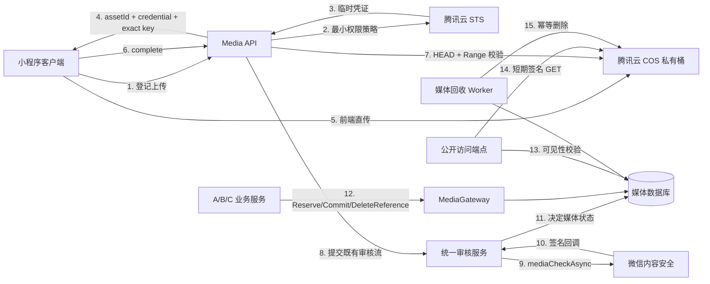
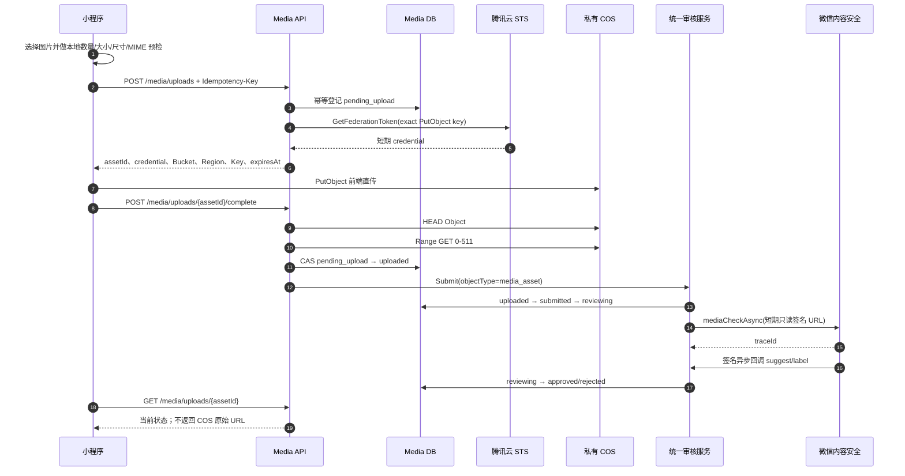
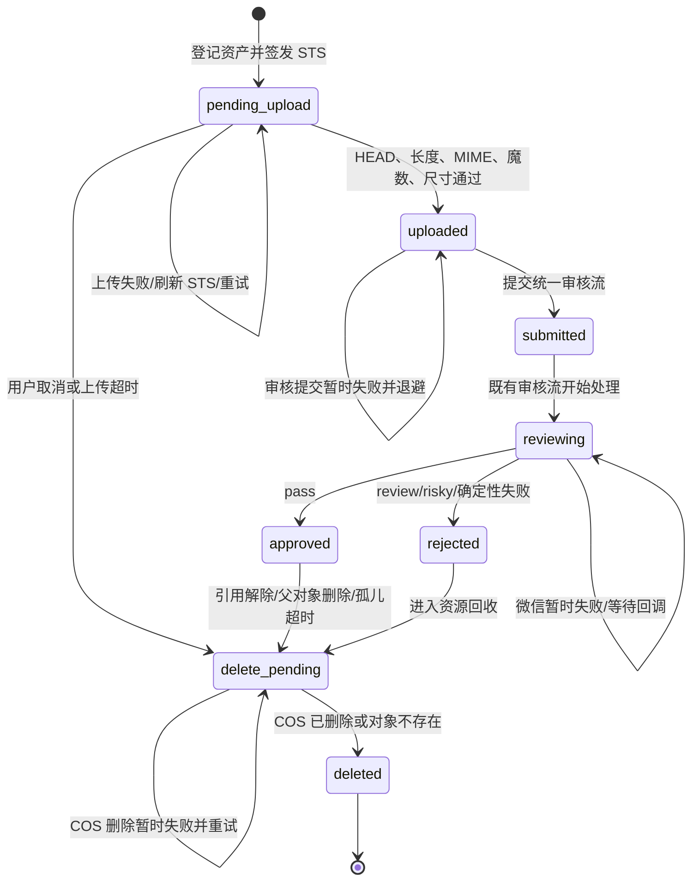
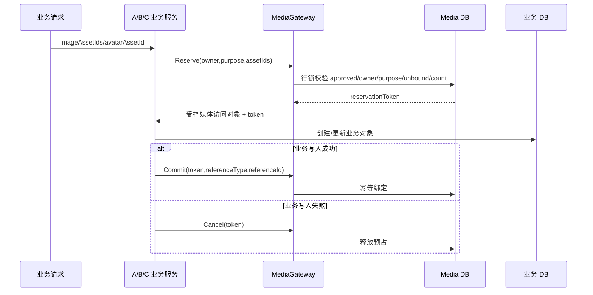

# P0-4 Media Pipeline Design v1.0

版本：v1.0
日期：2026-06-19
状态：**待架构评审，仅设计，禁止实施**
基线：Git Tag `p0-3-pass`（commit `588e1b3c`）
范围：社区帖子图片、二手商品图片、用户主动修改头像

## 1. 冻结边界与非目标

P0-1 权限体系、P0-2 社区闭环、P0-3 交易域、腾讯云 IM 业务逻辑、搜索架构、商品状态机及统一审核流均已冻结。本设计只能通过既有公开服务接口接入，不允许修改这些模块的业务规则或跨模块直接访问其数据库表。

P0-4 只解决图片资产的上传、校验、审核、引用、访问和回收，不包含：

- 视频、音频、普通文件或文件分享；
- 相册、图库、图片社交或推荐能力；
- 服务端图片中转上传；
- 服务端图片压缩、缩略图、水印、转码或多规格处理服务；
- 支付、订单、物流、广告或其他业务扩展；
- P0-5 的备份、恢复、全局监控、告警和发布回滚平台。

客户端可在上传前做本地尺寸收敛和质量压缩，但不得把它演变为新的后端图片处理服务，也不生成服务器侧多版本图片。

微信首次登录返回的头像仅作为客户端临时缓存展示，不登记为媒体资产、不写入正式头像字段。只有用户主动修改头像时，才进入本设计的上传和审核流程。

## 2. 目标与设计原则

唯一允许的新图片链路：

`客户端选图 → 本地预检 → 后端登记资产并签发短期 STS → 客户端直传私有 COS → 后端校验 COS 实物 → 复用统一审核流提交微信内容安全 → 审核通过 → 绑定业务对象 → MediaGateway 受控展示 → 拒绝/替换/删除后回收`

设计原则：

1. 图片字节不经过业务后端，避免后端带宽、内存和连接池成为瓶颈。
2. COS 永久密钥只存在后端；客户端只获得最小权限、精确对象 Key、短时有效的 STS 凭证。
3. COS 原始 URL 不进入业务层；A/B/C 只使用媒体资产 ID 和 MediaGateway 返回的访问对象。
4. 审核中、拒绝、删除中、未绑定或父业务对象不可见的图片一律不可公开展示。
5. 业务对象与图片资产通过媒体服务契约关联，禁止 A/B/C/F 直接查询或更新 `media_assets`。
6. 所有状态变化可审计，所有外部调用可重试，所有重复请求幂等。
7. 支持 1 万至 2 万用户规模，不提前引入超出 MVP 的图片处理基础设施。

## 3. 总体存储架构



组件职责：

- **Media API**：登记、凭证签发、完成确认、状态查询和取消。
- **MediaGateway**：向 A/B/C 提供 Reserve、Commit、Cancel、DeleteReference 和 Resolve；不暴露 COS URL。
- **统一审核服务**：沿用现有 `提交 → 审核 → 通过/拒绝 → 展示` 语义；媒体域只作为新审核目标适配器，不改变审核流规则。
- **COS Adapter**：STS、HEAD、Range GET、签名 GET 和 DeleteObject。
- **WeChat Adapter**：调用图片内容安全接口并验证异步回调。
- **GC Worker**：处理上传超时、审核拒绝、孤儿资产和引用解除后的对象删除。

## 4. COS 存储与目录规划

Bucket 必须为私有读写。P0-4 不创建公开读桶，也不允许业务层拼接 `cos://` 或 `https://<bucket>.cos...` 地址。

对象 Key 由后端生成：

```text
media/<env>/<purpose>/<yyyy>/<mm>/<owner-shard>/<public-id>.<ext>
```

示例：

```text
media/prod/post_image/2026/06/05/01JY8M4S8R4ZQH7N2P6K3A1C9W.webp
media/prod/product_image/2026/06/0c/01JY8M7J4P6E3A9T5N2B8D0F1K.jpg
media/prod/avatar/2026/06/11/01JY8M9Q7H2C5X4K8V6A3E0N1S.png
```

约束：

- `env` 隔离开发、预发布和生产对象；
- `purpose` 只能是 `post_image`、`product_image`、`avatar`；
- `owner-shard` 是用户 ID 的稳定分片，不泄露完整用户目录规模；
- `public-id` 使用高熵 ULID/随机 ID，禁止客户端文件名、连续数据库 ID和路径片段；
- 扩展名由服务端根据允许 MIME 决定；
- Key 永不复用，删除后也不覆盖旧对象；
- 原始文件名只可作为短期诊断元数据，不能进入 Key 或公开响应。

## 5. STS 临时凭证签发机制

后端使用腾讯云 STS `GetFederationToken`，默认有效期 10 分钟。每次登记资产时签发一组只允许当前对象 Key 的凭证。

允许动作：

- `name/cos:PutObject`，资源限定为当前 Bucket、Region 和精确 Key。

明确禁止：

- `ListBucket`、`GetBucket`；
- 读取任意对象；
- 删除对象；
- 覆盖其他 Key；
- 使用通配符用户目录；
- 获得永久 SecretId/SecretKey。

签发前必须校验：

- P0-1 JWT 有效，用户未封禁；
- `purpose` 在白名单中；
- 文件声明大小、MIME、扩展名和图片数量合法；
- 用户级速率和小时/日配额未超限；
- `Idempotency-Key` 格式合法；
- 当前用户对同 purpose 的 pending 资产数未超限。

STS policy 不能替代实物校验。客户端声明只用于拒绝明显非法请求，上传后的 COS HEAD、Content-Type、长度和文件魔数才是最终依据。

## 6. 上传数据流



前端直传失败：

- 网络错误时客户端可对同一 `assetId + Key` 重试；
- STS 过期后调用刷新凭证接口，仍使用同一精确 Key；
- `complete` 可重复调用，状态 CAS 保证只提交一次审核；
- 客户端异常退出后可通过状态接口恢复，不重新创建资产；
- 超过 `upload_expires_at` 仍未完成的资产进入回收队列。

## 7. 文件限制与图片数量

| 用途 | 单业务对象上限 | 单文件上传上限 | 最长边建议值 | 允许格式 |
| --- | ---: | ---: | ---: | --- |
| 社区帖子 | 9 张 | 10 MiB | 1920 px | JPEG、PNG、WebP |
| 二手商品 | 9 张 | 10 MiB | 1920 px | JPEG、PNG、WebP |
| 用户头像 | 1 张 | 5 MiB | 1024 px | JPEG、PNG、WebP |

最长边是客户端本地处理建议值；后端仍校验真实尺寸并拒绝异常像素面积。建议增加 `width × height ≤ 40,000,000` 和单边不超过 10,000 px 的解码炸弹保护门禁，最终阈值在设计评审中确认。

禁止：GIF、SVG、HEIC、BMP、TIFF、可执行文件、压缩包及 `application/octet-stream`。

校验分层：

1. 客户端：数量、声明大小、扩展名、可读取尺寸；仅用于快速反馈。
2. 上传登记：purpose、声明 MIME、大小、扩展名、数量、配额、幂等键。
3. 完成确认：COS 实际长度、Content-Type、文件魔数、图片宽高和像素面积。
4. 业务绑定：owner、purpose、approved、未删除、未绑定、数量上限。

任一层失败都不得进入公开展示；已上传实物进入异步删除流程。

## 8. 重复上传、并发和幂等

### 8.1 重复上传

- 客户端以 `purpose + 本地 SHA-256 + 文件大小` 生成建议幂等键；
- 数据库唯一约束 `(owner_user_id, idempotency_key)`；
- 同一用户重复请求返回同一资产及其当前状态；
- 不做跨用户哈希去重，防止通过哈希命中探测他人图片是否存在；
- 已删除资产的 Key 不复用，重新上传创建新资产。

### 8.2 并发处理

- 登记：唯一约束处理并发重复申请；
- complete：`WHERE status = pending_upload` CAS，只有一个请求提交审核；
- 审核回调：以 `review_task_id + trace_id` 幂等，终态不得回退；
- Reserve：对资产行加锁并一次校验全部资产，避免部分绑定；
- Commit/Cancel/DeleteReference：携带操作幂等键，重复调用返回既有结果；
- 删除：COS `NoSuchKey` 视为删除成功，重复任务安全收敛。

## 9. 内容安全审核方案

媒体审核必须纳入既有统一审核流，不建立平行审核状态体系：

1. 实物校验通过后，媒体服务通过审核服务公开接口提交 `object_type=media_asset` 的审核任务。
2. 既有审核流驱动 `submitted → reviewing`，媒体审核适配器调用微信图片内容安全接口。
3. 传给微信的是后端生成的短期只读签名 URL，不是永久公开 URL。
4. 微信异步回调必须验证签名、时间窗口、traceId 和目标状态。
5. `pass` 才可决定为 approved；`review/risky` 决定为 rejected。
6. 超时、限流、网络异常或协议异常保持不可展示，按指数退避重试；不得默认放行。
7. 重复或乱序回调不得覆盖 approved/rejected/deleted 终态。
8. 帖子或商品自身仍须通过既有内容审核；公开展示需要“父对象可见 + 所有引用图片 approved”双门禁。

审核失败处理：

- 业务接口不返回可展示地址；
- 用户状态接口返回受控错误码和可理解原因，不暴露微信原始风控细节；
- rejected 记录保留审计信息，COS 对象进入延迟删除；
- 删除完成后只保留必要审计元数据，不保留对象字节。

## 10. 图片状态机



禁止转换：

- rejected/deleted 回到 approved；
- pending_upload 直接 approved；
- reviewing 前绑定业务对象；
- approved 资产在删除请求登记后继续展示；
- 非 owner 取消未绑定资产；
- 已绑定资产经上传 API 直接删除。

每次转换必须写入 `media_asset_audits`，包含 asset、from/to、actor、reason、requestId 和时间，不记录密钥或签名 URL。

## 11. 数据库设计变更方案

实施阶段必须使用新迁移文件，不回写历史迁移。设计建议如下；评审通过前不执行迁移。

### 11.1 `media_assets`

| 字段 | 类型/约束 | 说明 |
| --- | --- | --- |
| `id` | BIGINT PK | 内部主键 |
| `public_id` | CHAR(26/32) UNIQUE | 高熵外部 ID |
| `owner_user_id` | BIGINT NOT NULL, INDEX | 上传者 |
| `purpose` | VARCHAR(24), INDEX | post_image/product_image/avatar |
| `object_key` | VARCHAR(512) UNIQUE | COS Key，不是 URL |
| `declared_mime` / `verified_mime` | VARCHAR(64) | 声明与实物 MIME |
| `declared_size` / `verified_size` | BIGINT UNSIGNED | 声明与实物大小 |
| `width` / `height` | INT UNSIGNED | 实际图片尺寸 |
| `content_hash` | CHAR(64) | 用户内幂等辅助，不做跨用户查询 |
| `status` | VARCHAR(24), INDEX | 媒体状态机 |
| `review_task_id` | BIGINT NULL UNIQUE | 既有审核任务 |
| `review_trace_id` | VARCHAR(128) NULL UNIQUE | 微信异步 trace |
| `review_suggest` / `review_label` | VARCHAR | 脱敏结论 |
| `reference_type` / `reference_id` / `reference_sort` | VARCHAR/BIGINT/INT | 业务引用 |
| `reservation_token` / `reservation_expires_at` | VARCHAR/DATETIME | 跨域绑定预占 |
| `idempotency_key` | VARCHAR(128) | 用户级幂等键 |
| `upload_expires_at` | DATETIME, INDEX | 未完成上传清理边界 |
| `review_attempts` / `review_available_at` | INT/DATETIME | 审核重试 |
| `delete_requested_at` / `storage_deleted_at` | DATETIME NULL | 逻辑与物理删除收敛 |
| `last_error` | VARCHAR(512) | 脱敏错误摘要 |
| `created_at` / `updated_at` / `deleted_at` | DATETIME | 审计和软删除 |

关键约束与热点索引：

- UNIQUE `public_id`、`object_key`；
- UNIQUE `(owner_user_id, idempotency_key)`；
- UNIQUE `review_task_id`；
- UNIQUE `review_trace_id`，允许 NULL；
- INDEX `(status, review_available_at, id)`；
- INDEX `(status, upload_expires_at, id)`；
- INDEX `(delete_requested_at, storage_deleted_at, id)`；
- INDEX `(reference_type, reference_id, reference_sort)`；
- INDEX `(owner_user_id, purpose, status, created_at)`。

### 11.2 `media_asset_audits`

| 字段 | 说明 |
| --- | --- |
| `id` | 主键 |
| `asset_id` | 媒体资产 ID |
| `from_status` / `to_status` | 状态变化 |
| `actor_type` / `actor_id` | user/system/wechat/admin |
| `action` / `reason` | 动作和脱敏原因 |
| `request_id` | 请求/任务关联 ID |
| `created_at` | 发生时间 |

索引：`(asset_id, created_at)`、`(request_id)`。

### 11.3 A/B/C 业务引用

- `post_images.asset_id BIGINT NULL`；
- `product_images.asset_id BIGINT NULL`；
- `users.avatar_asset_id BIGINT NULL`。

历史 URL 列只读兼容，所有新写入必须使用 approved 资产 ID。为保持模块边界，不建立 A/B/C 业务表指向媒体表的跨域数据库外键，也不得由业务仓储直接更新 `media_assets`；一致性由 MediaGateway 的 reservation 协议维护。

## 12. 关联关系与一致性协议



一致性规则：

- Reserve 必须一次锁定并验证全部资产，禁止部分成功；
- reservation 默认 15 分钟，过期自动释放；
- Commit 幂等，重复提交不得二次绑定；
- 业务更新时先绑定新资产，再解除旧资产引用；
- 帖子/商品审核拒绝、软删除，或头像替换时调用 DeleteReference；
- approved 但 24 小时未绑定的资产视为孤儿并进入回收；
- 业务父对象不可见时，即使图片 approved，公开访问也必须拒绝；
- 对账任务只通过各域公开查询/事件契约核对，不跨模块直接查询业务表。

## 13. 软删除、物理删除与 COS 回收

删除分两步：

1. **立即逻辑失效**：写入 `delete_requested_at` / `delete_pending`，MediaGateway 当场停止返回可访问对象。
2. **异步物理删除**：GC Worker 调用 COS DeleteObject；成功或 `NoSuchKey` 后写入 `storage_deleted_at` 并进入 deleted。

进入回收的场景：

- pending_upload 超时；
- 用户取消未绑定上传；
- 实物校验失败；
- 审核拒绝；
- uploaded/submitted/reviewing 长时间无法完成且达到确定性失败门禁；
- approved 后 24 小时仍未绑定；
- 帖子/商品被拒绝或删除；
- 商品/帖子图片被替换；
- 用户主动替换头像；
- 引用对账确认失去所有引用。

GC Worker 以 `(delete_requested_at, storage_deleted_at, id)` 分页领取任务，使用 lease/CAS 防止多实例重复工作。删除失败记录脱敏错误并指数退避；对象已不存在视为成功。P0-4 负责回收任务本身，任务监控、告警和跨区域灾备仍属于 P0-5，当前不启动。

COS Bucket 可配置兜底生命周期规则，例如清理专用临时前缀的超时对象；正式媒体 Key 的删除以数据库状态机为主，不能只依赖 Bucket 生命周期，以免误删仍有引用的对象。

## 14. 访问权限与 MediaGateway

业务层只能获得统一媒体访问对象，例如：

```json
{
  "assetId": "01JY...",
  "accessPath": "/api/v1/media/assets/01JY.../content",
  "mimeType": "image/webp",
  "width": 1280,
  "height": 960
}
```

禁止返回：COS Bucket、Region、ObjectKey、永久 URL、长期签名 URL或临时 Secret。

公开内容端点的展示条件：

- 媒体状态为 approved；
- 已绑定且未请求删除；
- 引用的帖子/商品/用户头像当前允许展示；
- 请求未命中撤销或风控门禁。

满足条件后返回 302 到 5 分钟内有效的 COS 签名 GET；未来接入 CDN、私有化存储或其他对象存储时只替换 MediaGateway/Storage Adapter，不修改 A/B/C。

未审核、拒绝、未绑定、删除中、已删除或越权资源统一返回 404，避免枚举资产状态。owner 查询上传状态使用独立鉴权接口，不复用公开访问端点。

## 15. API 清单

媒体 API 统一使用现有响应规范，不改变 P0-1 鉴权模型。

| 方法 | 路径 | 鉴权 | 幂等/限制 | 说明 |
| --- | --- | --- | --- | --- |
| POST | `/api/v1/media/uploads` | 用户 | `Idempotency-Key`、用户限流/配额 | 登记资产并签发 STS |
| POST | `/api/v1/media/uploads/:assetId/credentials` | owner | 同资产、精确 Key | STS 过期后刷新凭证 |
| POST | `/api/v1/media/uploads/:assetId/complete` | owner | 状态 CAS | 校验 COS 实物并提交审核 |
| GET | `/api/v1/media/uploads/:assetId` | owner | 读限流 | 查询上传、审核和清理状态 |
| DELETE | `/api/v1/media/uploads/:assetId` | owner、未绑定 | 幂等 | 取消并进入回收 |
| GET | `/api/v1/media/assets/:assetId/content` | 按父对象可见性 | 短期签名/防刷 | 受控访问 approved 图片 |
| GET/POST | `/api/v1/media/wechat/callback` | 微信签名 | trace 幂等、时间窗 | 接收内容安全结果 |

业务接口媒体字段设计：

- `POST /community/posts`：`imageAssetIds`，0–9；
- 社区帖子编辑接口如现有范围允许，只替换引用，不扩展业务能力；
- `POST/PUT /trade/products`：`imageAssetIds`，1–9；不得改变交易状态机或搜索规则；
- `PATCH /auth/me`：`avatarAssetId`，0 或 1；仅用户主动修改头像时使用；
- 首次微信登录头像不得调用媒体登记接口，也不得写 `avatarAssetId`。

## 16. 用户级防刷与配额

建议设计参数，评审后固化：

- 上传登记：每用户每分钟 10 次；
- 小时配额：帖子/商品图片合计 60 张，头像 10 张；
- 日配额：图片合计 200 张；
- 同时 pending/reviewing：最多 20 张；
- 单业务对象数量按第 7 节限制；
- STS 刷新只允许同 assetId、同 owner、同 Key，且次数受限；
- complete、状态查询和内容端点分别限流，禁止用统一宽松阈值。

限流失败不签发 STS，统一返回可识别错误码。P0-4 只定义并实现媒体接口级限流/配额；集群级可视化、告警与容量趋势属于 P0-5。

## 17. 容量与成本评估

估算假设：

- 1 万用户和 2 万用户两个规模；
- 每活跃用户每月上传 3 张；
- 客户端本地处理后平均 1 MiB/张；
- 审核拒绝、未完成和孤儿合计占 10%，在 24–72 小时内回收；
- 不生成缩略图或多规格副本。

| 规模 | 月上传数 | 月新增原始量 | 12 个月未计删除累计量 |
| --- | ---: | ---: | ---: |
| 1 万用户 | 3 万张 | 约 29.3 GiB | 约 351.6 GiB |
| 2 万用户 | 6 万张 | 约 58.6 GiB | 约 703.1 GiB |

主要计费项：

- COS 标准存储容量；
- PUT、HEAD、Range GET、签名 GET 和 DeleteObject 请求；
- 微信内容安全审核调用；
- COS 公网或 CDN 下行流量；
- STS 请求及应用侧数据库/worker 资源。

成本公式：

`月成本 = 平均存储量 × 存储单价 + 请求次数 × 请求单价 + 审核张数 × 审核单价 + 下行流量 × 流量单价`

设计期不固化易变化的云单价；真实上线预算必须在预发布验收时按腾讯云和微信控制台当期价格代入。成本控制依靠：客户端本地尺寸收敛、单文件/数量/配额限制、前端直传、私有缓存策略、拒绝与孤儿及时回收，以及不生成多规格副本。

## 18. 风险清单

| 等级 | 风险 | 影响 | 设计缓解 |
| --- | --- | --- | --- |
| 高 | STS policy 过宽或泄露 | 越权上传、覆盖或成本攻击 | 精确 Key、10 分钟 TTL、无读删列权限、用户配额 |
| 高 | 未审核图片被业务直接引用 | 违规内容公开 | approved + bound + parent-visible 三重门禁；业务只用 Gateway |
| 高 | MIME/扩展名伪造或解码炸弹 | 恶意文件、资源耗尽 | HEAD、魔数、尺寸、像素面积和允许格式联合校验 |
| 高 | 微信审核失败时默认放行 | 安全门禁失效 | fail-closed，失败保持不可展示并重试 |
| 中 | 数据库与 COS 最终一致延迟 | 孤儿对象或已删对象短时残留 | 立即逻辑失效、GC lease/CAS、NoSuchKey 幂等 |
| 中 | 回调重复或乱序 | 状态回退、重复审核 | trace/task 唯一约束与终态保护 |
| 中 | 业务写成功但媒体 Commit 失败 | 引用不一致 | reservation、幂等 Commit、过期释放与对账 |
| 中 | 热门图片签名请求形成热点 | API 压力和流量成本 | 短期签名缓存、防刷；CDN 仅预留不在本阶段启用 |
| 中 | 用户频繁上传后放弃 | 审核与存储成本膨胀 | pending 上限、小时/日配额、孤儿快速回收 |
| 低 | 历史 URL 与新资产并存 | 迁移期行为复杂 | 历史只读、新写强制 assetId、分阶段迁移 |
| 低 | 客户端 WebP 兼容差异 | 上传失败或预览异常 | JPEG/PNG 回退；服务端仍按实物 MIME 校验 |

## 19. 专项验收标准

设计评审通过不等于开发验收通过。开发完成后必须逐项提供真实环境证据。

### 19.1 上传链路

- 客户端选择、预检、可选本地压缩、登记、STS、COS 直传、complete、状态查询全链路通过；
- 后端没有图片字节中转接口；
- STS 过期、断网和应用重启后可基于同 assetId 恢复；
- 重复 complete 不产生重复审核。

### 19.2 COS

- 真实 COS 私有桶上传成功；
- policy 只有精确 Key PutObject；
- 永久 SecretId/SecretKey 不下发、不写日志；
- HEAD、Range、签名 GET、DeleteObject 和 NoSuchKey 幂等均通过；
- 业务响应不包含 COS 原始 URL。

### 19.3 微信内容安全与统一审核流

- 真实微信内容安全接口成功调用；
- 每个媒体资产对应既有统一审核任务；
- pass 才 approved；review/risky 不可展示；
- 错误签名、未知 trace、重复/乱序回调不能改变合法状态；
- 审核延迟和暂时故障保持 fail-closed，并能重试恢复。

### 19.4 安全

- 非 owner 获取凭证、完成、查询或删除均拒绝；
- MIME、扩展名、魔数、大小、尺寸和数量绕过测试通过；
- SVG、GIF、可执行内容、超大像素图片被拒绝；
- 用户级频率、小时和日配额生效；
- 公开内容端点无法访问未审核、未绑定、删除中或父对象不可见资产。

### 19.5 并发与一致性

- 20 路重复登记只创建一个资产；
- 20 路 complete 只提交一次审核；
- 多图 Reserve 全成或全败；
- 重复 Commit/Cancel/DeleteReference 幂等；
- 媒体记录、业务引用和 COS 实物最终一致；
- 状态审计记录完整且无敏感信息。

### 19.6 垃圾回收

- 未上传超时、实物校验失败、审核拒绝、未绑定孤儿、引用解除均进入回收；
- 删除请求登记后立即停止访问；
- COS 暂时失败后可重试并最终写入 `storage_deleted_at`；
- 多实例 GC 不重复破坏状态，不误删仍有引用的对象。

### 19.7 工程门禁

- `go test ./...`、`go vet ./...`；
- A–F 边界检查；
- 管理端和小程序 Type Check / Build；
- 数据库迁移从空库和现存库均通过；
- 真实 COS 与真实微信环境联调，禁止 Mock 替代；
- 输出《P0-4 Media Pipeline Acceptance Report v1.0》后才能判定 PASS/Conditional PASS/NO-GO。

## 20. 评审决策点

进入开发前必须书面确认：

1. 文件大小、最长边和像素面积阈值；
2. 小时/日配额和 pending 上限；
3. STS TTL、reservation TTL、孤儿回收时间；
4. 微信内容安全接口、回调协议和统一审核目标适配方式；
5. COS Bucket、Region、私有读写、CORS 和生命周期兜底规则；
6. MediaGateway 返回对象与业务引用协议；
7. 历史 URL 的只读兼容和迁移策略；
8. 真实云验收账号、测试图片和脱敏证据保存方式。

在上述决策全部通过前，禁止创建或修改 P0-4 迁移、后端媒体代码、小程序上传代码和部署配置；禁止启动 P0-5。

## 21. 当前阶段结论

本文件是 P0-4 的设计候选稿，不是开发完成声明，也不是专项验收报告。P0-3 已在 `p0-3-pass` 基线正式冻结。P0-4 只有在本设计评审通过后，才能进入独立开发与验收阶段。
