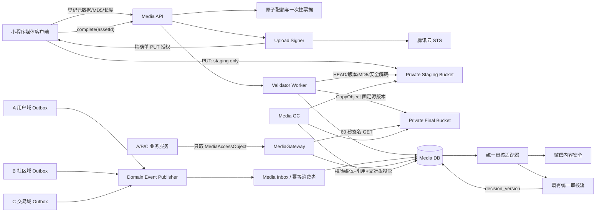
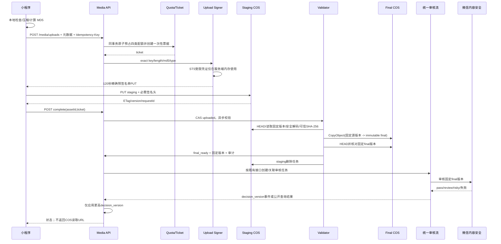
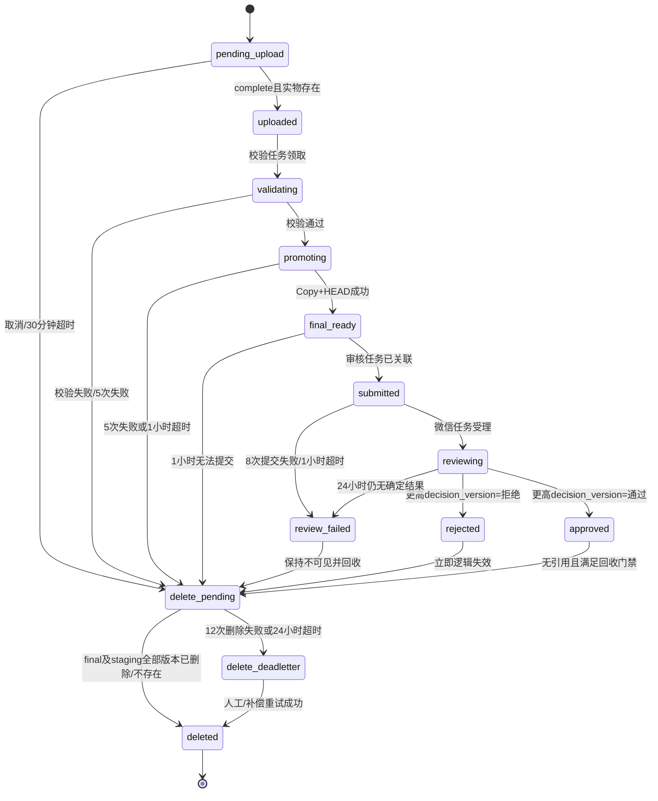
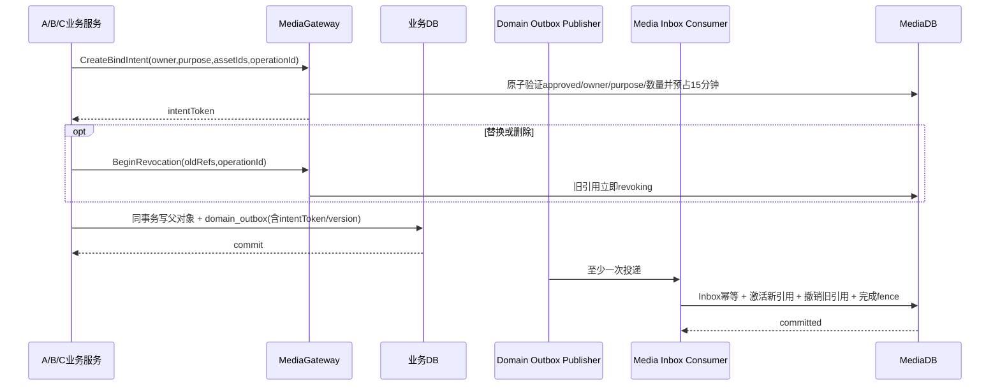

# P0-4 Media Pipeline Design v1.1

版本：v1.1（Architecture Review 整改版）  
日期：2026-06-20  
基线：`p0-3-pass`  
替代文档：`P0-4 Media Pipeline Design v1.0`  
状态：**架构复审候选稿；仅设计，不代表开发或真实云验收完成**

## 1. 文档目的与冻结边界

本版只修订 P0-4 图片链路设计，关闭《P0-4 Architecture Review Report》第 8、9 节列出的设计风险。P0-1 权限体系、P0-2 社区闭环、P0-3 交易域、腾讯云 IM、搜索、商品状态机、通知和统一审核语义均保持冻结；P0-5 不启动。

覆盖范围仅为：

- 社区帖子图片；
- 二手商品图片；
- 用户主动修改的头像。

首次微信登录头像只能作为客户端缓存显示，不创建媒体资产、不写入 `avatar_asset_id`、不进入审核。本文不引入视频、文件、相册、服务端压缩、多规格图片、CDN、推荐、支付、订单、物流或聊天能力。

## 2. 已固化的安全不变量

以下是不依赖“开发后再决定”的硬约束：

1. 客户端只能写入一个精确的 `staging Key`，永远不能写 `final Key`。
2. 客户端不获得可自行签名任意 COS 请求的 SecretKey；上传授权只能完成一次精确的单 PUT。
3. 上传请求在 COS 入口绑定精确 `Content-Length`、`Content-MD5`、`Content-Type` 和 Key；超限对象不得完整落入 final。
4. 禁止 multipart 的创建、分片上传、列举和合并权限。
5. staging 校验通过后，只能由后端服务角色执行 `CopyObject(sourceVersion -> final immutable Key)`。
6. 微信内容安全审核、展示和删除始终指向同一 `final_key + final_version_id`。
7. final Key 内容寻址、禁止覆盖、开启版本控制；应用只读取数据库固定的版本。
8. 审核事实源是既有统一审核任务；`media_assets` 只保存带 `decision_version` 的可重建投影。
9. 业务引用以 `media_asset_references` 为事实源，`active_ref_count` 只允许作为可重建缓存。
10. A/B/C 的引用绑定、替换、解绑必须由“同业务事务 Outbox + Media 幂等 Inbox”收敛，禁止跨域直写媒体表。
11. 未审核、审核失败、引用未激活、父对象不可见或进入删除流程的图片一律 fail-closed。
12. final 物理删除前必须同时证明：无 active/pending 引用、无有效绑定意图、无未消费 Outbox、保留期已到。

## 3. 总体架构



### 3.1 组件职责

- **Media API**：资产登记、票据、上传授权、complete、状态查询、取消。
- **Upload Signer**：在可信环境取得受限 STS，仅生成精确请求的预签名单 PUT；临时 Secret 不返回客户端。
- **Validator Worker**：验证 COS 实物、完整解码、计算 SHA-256、复制 final、核对复制结果。
- **Review Adapter**：接入微信内容安全并把结果交给既有统一审核流，不改变其语义。
- **Media Inbox Consumer**：幂等消费 A/B/C Outbox，维护标准化引用和父对象可见性投影。
- **MediaGateway**：向业务层返回访问对象；业务层不得看到或拼接 COS URL。
- **Media GC**：分别治理 staging 残留和 final 无引用对象。

## 4. 双阶段 COS 对象模型

### 4.1 Bucket 与 Key

staging 与 final 使用两个私有 Bucket；至少必须使用两套互不重叠的前缀和 IAM 资源策略。推荐独立 Bucket，以便独立生命周期、预算和权限隔离。

```text
staging/<env>/<ownerShard>/<ownerPublicId>/<assetPublicId>/<uploadNonce>.<ext>
final/<env>/<purpose>/<yyyy>/<mm>/<assetPublicId>/<sha256>.<verifiedExt>
```

固定规则：

- `ownerShard = lower(hex(SHA-256(ownerPublicId)))[0:4]`，仅用于目录均衡，不参与鉴权；
- `assetPublicId` 固化为 26 位大写 ULID；
- `uploadNonce` 为 128 bit CSPRNG，单票据唯一；
- final Key 同时包含资产 ID 和服务端可信 SHA-256，不跨用户推断内容；
- 路径全部由服务端生成，客户端不得提交 Key、Bucket、Region 或目录；
- 扩展名来自服务端验证格式，只允许 `.jpg`、`.png`、`.webp`。

### 4.2 staging 权限

- 仅单次 `PutObject`，资源限定到一个精确 Key；
- 明确拒绝 `InitiateMultipartUpload`、`UploadPart`、`CompleteMultipartUpload`、`ListParts`、`AbortMultipartUpload`；
- 无 `GetObject`、`DeleteObject`、`ListBucket`、`CopyObject` 和前缀通配权限；
- 签名请求固定 `Content-Length`、`Content-MD5`、`Content-Type`、`x-cos-forbid-overwrite:true`；
- 预签名 URL 120 秒有效，票据不可再次签发；网络失败必须创建新票据和新 staging Key；
- staging Bucket 开启版本控制作为纵深防御，complete 固定读取具体 `version_id`。

### 4.3 final 不可变性

- 只有 Media 服务角色能从 staging 执行服务端 `CopyObject`；
- CopySource 必须带已验证的 `staging_version_id`；
- CopyObject 使用禁止覆盖条件；若 final 已存在，只能在 SHA-256、长度、格式完全一致时作为幂等成功；
- final Bucket 开启版本控制，数据库固定 `final_version_id`；
- Copy 后必须 HEAD final 并核对长度、ETag/CRC64、元数据和版本；
- 审核 URL、MediaGateway GET 和删除任务都使用固定 final 版本；
- final 不配置自动生命周期删除规则，物理删除只能由 GC 在数据库门禁通过后执行。

由此，旧上传授权即使尚未过期，也只能尝试重放同一个 staging 请求，无法替换已审核或正在展示的 final 对象。

## 5. 一次性上传授权与入口硬限制

### 5.1 授权模式的确定

客户端不直接接收 STS 的 `TmpSecretKey`。Upload Signer 在后端取得只针对精确 staging Key 的短期 STS，并生成预签名单 PUT，向客户端只返回：

```json
{
  "assetId": "01JY...",
  "uploadUrl": "<120秒预签名PUT，仅媒体上传客户端可见>",
  "requiredHeaders": {
    "Content-Type": "image/webp",
    "Content-MD5": "base64-md5",
    "x-cos-forbid-overwrite": "true"
  },
  "contentLength": 387421,
  "expiresAt": "2026-06-20T12:02:00Z"
}
```

`Content-Length` 必须进入 COS V5 签名的 canonical headers，由 HTTP 客户端根据已确定的 Blob 自动发送。修改 Key、长度、MD5、MIME 或必需头部应导致 COS 在接收完整对象前拒绝请求。禁止退回“把 STS Secret 发给客户端后仅做事后 HEAD”的旧方案。

真实 COS 对上述头部约束的负向 POC 是开发阶段第一个、独立的 Gate-0：若浏览器/小程序网络栈与 COS 不能共同强制精确长度，开发必须停在 Gate-0，不得放宽为原始 STS。替代方案只能是腾讯云已证明支持的 `content-length-range` 等价入口约束；独立 staging Bucket、全局硬签发预算和 24 小时生命周期仍必须保留，不能单独替代入口限制。

### 5.2 一次性业务票据

票据服务端保存哈希，明文只返回一次。载荷固定包含：

- `ticket_id`、`nonce`、`asset_id`、`owner_user_id`；
- `staging_key`、`purpose`；
- `expected_size`、`expected_md5`、`declared_mime`；
- `quota_reservation_id`、`issued_at`、`expires_at`；
- 票据状态和授权签发次数。

状态为 `created -> authorization_issued -> uploaded -> consumed`，或 `expired/cancelled`。数据库约束保证每个票据最多一次 `authorization_issued`；相同明文票据重放返回 409。COS 层由精确签名、短 TTL 和 `x-cos-forbid-overwrite` 阻止重复对象写入。

### 5.3 原子字节配额

配额在创建票据时按声明字节预占，不在 complete 后才计算。MVP 使用 MySQL 条件更新，避免为 P0-4 引入新基础设施：

```sql
UPDATE media_quota_windows
SET reserved_bytes = reserved_bytes + :bytes,
    reserved_count = reserved_count + 1,
    version = version + 1
WHERE user_id = :user
  AND window_type = :window
  AND window_start = :start
  AND reserved_bytes + used_bytes + :bytes <= :byte_limit
  AND reserved_count + used_count + 1 <= :count_limit;
```

一分钟、小时、日、pending 四个窗口必须在同一数据库事务内全部成功；任一更新影响 0 行则整体回滚，不签发票据。`media_quota_reservations` 以 `ticket_id` 唯一，commit/release 使用 CAS，保证只结算一次。

固化阈值：

| 窗口 | 资产数 | 声明字节 |
| --- | ---: | ---: |
| 每分钟 | 12 | 100 MiB |
| 每小时 | 60 | 500 MiB |
| 每日 | 200 | 1 GiB |
| 同时 pending/reviewing | 20 | 200 MiB |
| 全局 staging 每日签发 | — | 20 GiB |
| 全局 staging 每月签发 | — | 100 GiB |

全局阈值达到后 fail-closed 停止新票据，不影响已批准图片读取。阈值是 2 万用户 MVP 的初始硬门禁，调整必须有容量评审和审计记录。

## 6. 文件、安全与数量门禁

| purpose | 单文件上限 | 数量 | 最长边 | 最大像素 | 允许格式 |
| --- | ---: | ---: | ---: | ---: | --- |
| post_image | 10 MiB | 每帖 9 | 8192 px | 40 MP | JPEG/PNG/静态 WebP |
| product_image | 10 MiB | 每商品 9 | 8192 px | 40 MP | JPEG/PNG/静态 WebP |
| avatar | 5 MiB | 当前头像 1 | 4096 px | 16 MP | JPEG/PNG/静态 WebP |

客户端应把最长边收敛到 2048 px，优先生成 WebP，目标平均不超过 400 KiB；这只是成本优化，不能替代服务端安全门禁，也不引入服务端图片压缩服务。

服务端必须依次执行：

1. HEAD 固定 staging 版本，校验长度、Content-MD5/ETag、Content-Type、版本和对象存在性；
2. 使用受限 CPU、内存、总读取字节和超时的解码沙箱完整解码；
3. 从实物识别 JPEG/PNG/WebP，拒绝 SVG、GIF、BMP、TIFF、HEIC、可执行内容、动画 WebP；
4. 校验真实 width、height、像素面积、帧数和文件尾，不信任扩展名或声明 MIME；
5. 重新计算 SHA-256；同一用户、同一 purpose 才允许基于可信哈希去重；
6. final 响应固定 `verified_mime`，增加 `X-Content-Type-Options: nosniff`。

解码失败、polyglot、截断文件、压缩炸弹、维度越限、MD5 不符全部转 `delete_pending`，且不提交审核。

## 7. 完整上传与审核数据流



失败恢复：

- 登记接口以 `(owner_user_id, idempotency_key)` 幂等；相同键但元数据不同返回 409；
- 授权过期后不能刷新原票据，创建新票据和新 Key，旧配额由过期任务释放；
- complete 重复调用只返回当前状态，不重复验证、复制或提交审核；
- CopyObject 和审核提交均使用资产 ID + 目标版本作为幂等键；
- 客户端只需保存 `assetId`，重启后通过状态接口恢复。

## 8. 审核事实源与可见性

既有统一审核任务是唯一审核事实源。微信回调只是证据输入，不直接把 `media_assets` 改为 approved。媒体投影字段为：

- `review_task_id`；
- `applied_decision_version`；
- `projected_decision`；
- `projected_decided_at`。

规则：

1. 统一审核服务每次决定产生同一任务内单调递增的 `decision_version`；
2. Media Consumer 仅在 `incoming_version > applied_decision_version` 时 CAS 更新；
3. 重复、乱序、旧版本和未知任务事件只记审计，不改变状态；
4. 人工复核仍通过既有审核流形成新版本，不由媒体域自行改判；
5. 微信超时或不可用时保持不可见并重试，禁止默认通过；
6. 父对象审核拒绝/删除只撤销引用，不回写或篡改媒体审核事实；
7. 媒体后续被判风险时，MediaGateway 先 fail-closed，再由既有审核服务处理，不跨域修改父对象业务状态。

唯一展示公式：

```text
media.status = approved
AND media.projected_decision = approved
AND reference.state = active
AND reference.parent_visibility = visible
AND media.delete_requested_at IS NULL
AND media.final_key IS NOT NULL
AND media.final_version_id IS NOT NULL
AND reference.revocation_fence IS NULL
```

任何条件未知都按 false 处理。

## 9. 媒体状态机与 TTL



| 状态/任务 | TTL | 最大重试 | 到期动作 |
| --- | --- | ---: | --- |
| pending_upload | 30 分钟 | 授权只签 1 次 | 释放配额，删 staging |
| uploaded/validating | 1 小时 | 5 | 校验失败，delete_pending |
| promoting | 1 小时 | 5 | delete_pending |
| final_ready/submitted | 1 小时 | 8 | review_failed |
| reviewing | 24 小时 | 查询/补偿 8 次 | review_failed，fail-closed |
| rejected/review_failed | 立即不可见 | — | 1 小时内请求物理删除 |
| approved 未绑定 | 24 小时 | — | 通过 Outbox/intent 门禁后删除 |
| revocation fence | 2 分钟 | — | 未被 Outbox 确认则自动解除 |
| delete_pending | 24 小时 | 12，指数退避 | delete_deadletter，仍不可见 |
| Outbox | 7 天热重试 | 20 | dead-letter，不丢事件 |
| Inbox 去重记录 | 180 天 | — | 到期归档/清理 |
| 审计记录 | 365 天 | — | 脱敏清理 |

重试建议为 30 秒、1 分、2 分、5 分、15 分、30 分、1 小时、2 小时后按任务 TTL 调整；不得突破状态截止时间。dead-letter 的告警和可视化属于 P0-5，本阶段只定义表、重放接口和不丢失语义。

## 10. 标准化引用模型

采用标准化多引用，不使用 `media_assets.reference_type/reference_id` 作为事实。一个用户自己的同一 approved 资产可在相同 purpose 的多个合法业务位置复用；禁止跨用户物理去重或复用。

`media_asset_references` 每一行代表一个业务槽位：

- `reference_type`：`post_image | product_image | user_avatar`；
- `reference_id`：父对象公开 ID，不是跨域数据库外键；
- `slot`：帖子/商品为 0–8，头像为 0；
- `state`：`pending | active | revoking | revoked`；
- `parent_visibility`：`pending | visible | hidden | deleted`；
- `aggregate_version`：父对象引用集合版本，单调递增；
- `operation_id`：来源 Outbox 操作 ID；
- `revocation_fence` 和过期时间。

唯一约束：

- `(reference_type, reference_id, slot)`；
- `(asset_id, reference_type, reference_id, slot)`；
- `operation_id` 在对应操作范围内唯一。

`media_assets.active_ref_count` 是事务内维护的缓存，只能通过引用行聚合重建。GC 必须直接检查引用表和事件门禁，不能仅依赖该计数。

## 11. 业务 Outbox + Media Inbox 最终一致性

### 11.1 事件契约

A/B/C 各自在自己的数据库、与父业务对象创建/编辑/删除同一事务中写入 `domain_outbox`，不调用媒体表。允许的 P0-4 钩子事件只有：

- `MediaReferenceSetRequested`：创建或整体设置图片槽位；
- `MediaReferenceReplaceRequested`：替换头像或图片集合；
- `MediaReferenceRevokeRequested`：父对象删除、拒绝、下架展示或主动移除图片；
- `MediaParentVisibilityChanged`：仅投影既有父对象展示状态，不创造新业务状态。

事件包含：`event_id`、`operation_id`、`aggregate_type`、`aggregate_id`、`aggregate_version`、`owner_user_id`、目标引用集合、目标可见性、`occurred_at`、schema version。事件不包含 COS URL、密钥或图片字节。

### 11.2 幂等与乱序

Media Consumer 在一个媒体数据库事务内：

1. 以 `event_id` 插入 `media_event_inbox`；冲突即幂等成功；
2. 锁定同一父对象投影；
3. 小于当前 `aggregate_version` 的事件记为 stale 并忽略；
4. 等于当前版本且 payload hash 相同视为重复；相同版本但 hash 不同进入 dead-letter；
5. 更高版本按目标集合 upsert 引用、撤销缺失槽位并更新父对象可见性；
6. 重算 `active_ref_count` 缓存、写审计、标记 Inbox applied 后提交。

发布器至少一次投递；消费者必须能承受重复、延迟和乱序。Outbox 只有在发布确认后标记 sent，失败保持可重试，禁止“先标记成功再发送”。

### 11.3 Revocation Fence

Outbox 保证最终一致，但删除/替换必须先阻断访问：

1. 业务服务在执行删除/替换事务前，通过 MediaGateway 创建 2 分钟 `revocation fence`；失败则业务变更 fail-closed，不提交；
2. fence 立即让旧引用不可访问；
3. 业务事务提交父对象变化并写 Outbox；
4. Consumer 应用事件后把 fence 固化为 revoked；
5. 业务事务回滚时可 best-effort 取消 fence；即使取消调用失败，fence 2 分钟后自动解除，不会误删资源。

该钩子只控制媒体可见性，不改变帖子、商品、头像、审核或权限的业务语义。

### 11.4 创建与替换数据流



创建事务成功但消费延迟时，新图片保持不可见且不会被 GC；删除事务成功后旧图片已被 fence 立即阻断。对账只通过各域公开事件/服务契约，不允许媒体仓储直接查询 A/B/C 表。

## 12. 数据库变更设计

本节只定义未来迁移，不在设计阶段执行。

### 12.1 `media_assets`

| 字段 | 约束/说明 |
| --- | --- |
| `id` | BIGINT PK |
| `public_id` | CHAR(26) UNIQUE，大写 ULID |
| `owner_user_id` | BIGINT NOT NULL，索引 |
| `purpose` | VARCHAR(24) NOT NULL |
| `staging_bucket` / `staging_key` / `staging_version_id` | key 唯一；仅媒体域可见 |
| `final_bucket` / `final_key` / `final_version_id` | final key 唯一；批准前可为空 |
| `declared_mime` / `verified_mime` | 声明与可信类型 |
| `declared_size` / `verified_size` | BIGINT UNSIGNED |
| `content_md5` / `trusted_sha256` | CHAR(24)/CHAR(64) |
| `staging_etag` / `final_etag` / `final_crc64` | 实物证据 |
| `width` / `height` / `frame_count` | 强制解码结果 |
| `status` | 媒体技术状态 |
| `review_task_id` | UNIQUE NULL |
| `applied_decision_version` | BIGINT NOT NULL DEFAULT 0 |
| `projected_decision` | pending/approved/rejected/failed |
| `active_ref_count` | 可重建缓存，非 GC 单一依据 |
| `upload_expires_at` / `review_deadline_at` | TTL 索引 |
| `delete_requested_at` / `storage_deleted_at` | 逻辑/物理删除 |
| `row_version` | CAS 版本 |
| `created_at` / `updated_at` / `deleted_at` | 审计/软删除 |

核心索引：

- UNIQUE `public_id`、`staging_key`、`final_key`；
- INDEX `(status, upload_expires_at, id)`；
- INDEX `(status, review_deadline_at, id)`；
- INDEX `(status, delete_requested_at, id)`；
- INDEX `(owner_user_id, purpose, trusted_sha256, status)`；
- INDEX `(review_task_id, applied_decision_version)`。

### 12.2 `media_upload_tickets`

包含 `ticket_id`、`ticket_hash UNIQUE`、`asset_id UNIQUE`、owner、精确 Key/size/MD5/MIME、state、`authorization_issued_at`、`credential_issue_count CHECK <= 1`、quota reservation、过期时间和 CAS 版本。

### 12.3 配额表

- `media_quota_windows`：UNIQUE `(scope_type, scope_id, window_type, window_start)`，保存 reserved/used count 和 bytes；
- `media_quota_reservations`：`ticket_id UNIQUE`，状态 `reserved|committed|released`，CAS 结算；
- 全局和用户配额使用同一事务、同一条件更新算法。

### 12.4 `media_asset_references`

包含第 10 节字段及 UNIQUE `(reference_type, reference_id, slot)`、UNIQUE `(asset_id, reference_type, reference_id, slot)`，索引 `(asset_id,state)`、`(reference_type,reference_id,state)`、`(revocation_expires_at,state)`。

### 12.5 `media_bind_intents`

保存 `operation_id UNIQUE`、owner、purpose、asset 集合 hash、状态、15 分钟过期时间。GC 在 intent 有效、对应 Outbox 未决时不得删除资产。

### 12.6 `media_event_inbox`

保存 `event_id UNIQUE`、operation、aggregate、version、payload hash、`received/applied/deadletter` 状态、错误摘要和时间。UNIQUE `(aggregate_type,aggregate_id,aggregate_version)` 结合 payload hash 检测同版本冲突。

### 12.7 各域 `domain_outbox`

各域通过自己的迁移建立：`event_id UNIQUE`、aggregate、version、event type、payload、status、attempts、available_at、sent_at、last_error、created_at。索引 `(status,available_at,id)`。Outbox 与父业务写入同一事务，不设跨域外键。

### 12.8 审计与 GC

- `media_asset_audits`：资产、引用、票据、配额和状态变化；不记录 Secret、签名 URL、原始微信响应；
- `media_gc_jobs`：对象阶段、固定 Key/version、原因、lease、attempts、available_at、deadletter；UNIQUE `(asset_id,object_stage,object_version,reason)`。

## 13. GC 与资源回收

### 13.1 staging GC

优先级从高到低：

1. 超限、MD5 不符、恶意格式：立即删除；
2. Copy 成功后的 staging：立即入队，15 分钟内删除；
3. pending 超 30 分钟、授权过期、用户取消：1 小时内删除；
4. 独立 staging Bucket 生命周期：创建后 24 小时删除所有当前和历史版本，作为最终兜底。

staging 生命周期规则必须只匹配 staging Bucket，绝不能覆盖 final。

### 13.2 final GC

审核拒绝/review_failed 在 1 小时内请求删除。approved 资产只有满足下式才可进入物理删除：

```text
no active/pending/revoking references
AND no unexpired bind intent
AND no unconsumed/deadletter reference Outbox known by event contract
AND active_ref_count reconciliation = 0
AND retention deadline reached
AND delete_requested_at IS NOT NULL
```

GC 用 lease + CAS 分页领取；删除具体 version，再删除 delete marker/历史版本。`NoSuchKey`/`NoSuchVersion` 视为幂等成功。失败指数退避，12 次或 24 小时进入 dead-letter，资源保持不可访问。

### 13.3 引用对账

每日对账是 P0-4 数据任务，不是 P0-5 监控专项：

- 从媒体 Inbox/引用表与各域公开快照事件对账；
- 修复 `active_ref_count` 缓存；
- 对缺失事件请求各域按 aggregate version 重放；
- 禁止直接查询用户、帖子或商品表；
- 无法证明无引用时一律不删。

## 14. MediaGateway 与访问控制

业务层只能获得：

```json
{
  "mediaId": "01JY...",
  "referenceId": "01JZ...",
  "accessPath": "/api/v1/media/references/01JZ.../content",
  "mimeType": "image/webp",
  "width": 1440,
  "height": 1080
}
```

禁止返回 Bucket、Region、object key、versionId、永久 URL、签名 URL或任何临时密钥。上传授权 URL 仅由媒体上传客户端在上传接口短暂接收，不进入 A/B/C 业务对象或日志。

内容端点每次计算第 8 节可见性公式，成功后 302 到绑定 `final_key + final_version_id` 的 60 秒签名 GET：

- `Cache-Control: private, max-age=45`；高敏撤销场景可 `no-store`；
- 删除/撤销后最长残留访问窗口为 60 秒；
- 签名 URL 不写数据库、不进入应用日志、不作为消息或业务字段传递；
- STS/上传授权没有读取权限；
- 未批准、未绑定、父对象隐藏、删除中、越权统一返回 404；
- 响应使用可信 MIME 和 `X-Content-Type-Options: nosniff`。

未来 CDN 或其他存储只替换 MediaGateway/Storage Adapter，不改变业务引用协议；本阶段不接入。

## 15. CORS 最小策略

生产 staging Bucket 仅配置：

- AllowedOrigins：生产环境精确白名单，禁止 `*`；开发者工具域名只存在于非生产 Bucket；
- AllowedMethods：仅 `PUT`；
- AllowedHeaders：`Content-Type`、`Content-MD5`、`x-cos-forbid-overwrite` 及腾讯签名实际必需的最小头集合；
- ExposeHeaders：`ETag`、`x-cos-request-id`、`x-cos-version-id`；
- MaxAgeSeconds：300；
- 不允许 Cookie/credentials，不允许 GET/POST/DELETE/LIST。

final Bucket 不开放浏览器跨域直写；读取只接受 MediaGateway 签发的短期 GET。CORS 配置必须版本化、在真实 COS 做允许/拒绝矩阵测试。

## 16. API 契约

| 方法 | 路径 | 鉴权 | 幂等/约束 | 说明 |
| --- | --- | --- | --- | --- |
| POST | `/api/v1/media/uploads` | 登录用户 | `Idempotency-Key`、原子配额 | 创建资产、票据和精确上传授权 |
| POST | `/api/v1/media/uploads/:id/complete` | owner | ticket + 状态 CAS | 只确认；服务端验证实物 |
| GET | `/api/v1/media/uploads/:id` | owner | 读限流 | 查询状态/失败原因/恢复动作 |
| DELETE | `/api/v1/media/uploads/:id` | owner 且未绑定 | 幂等 | 取消并进入清理 |
| GET | `/api/v1/media/references/:id/content` | 按父对象可见性 | 60 秒签名、防刷 | 返回受控媒体内容 |
| POST | `/api/v1/media/wechat/callback` | 微信签名 | trace + decision version | 回调证据进入既有审核流 |
| POST | `/internal/media/bind-intents` | A/B/C 服务身份 | operation 幂等 | 预占 approved 资产 |
| POST | `/internal/media/revocation-fences` | A/B/C 服务身份 | operation 幂等 | 删除/替换前立即阻断旧引用 |
| DELETE | `/internal/media/revocation-fences/:op` | A/B/C 服务身份 | 幂等 | 事务回滚时 best-effort 取消 |
| POST | `/internal/media/events/replay` | 受控后台任务 | event 幂等 | 重放 dead-letter；不是新业务功能 |

统一响应只使用现有规范。上传登记校验 purpose、owner、声明长度、MD5 格式、MIME、数量上下文；数量最终由绑定 intent 再校验，禁止绕过业务对象上限。

## 17. 重复上传与并发

- 请求幂等键与内容哈希分离；同一键但参数不同返回 409；
- Content-MD5 是入口完整性约束，可信 SHA-256 只能由服务端验证后产生；
- 同用户、同 purpose、相同可信 SHA-256 的 approved 资产可返回 canonical asset；重复 staging/final 进入清理；
- 不跨用户查重，不通过查重接口泄露他人是否上传过某内容；
- 20 路登记由唯一键只创建一项资产/票据；
- 20 路 complete 由 CAS 只启动一次校验、Copy 和审核；
- 多图 bind intent 必须一次锁定并全成全败；
- 配额条件更新保证并发总和不突破字节和数量上限；
- Outbox 重复/乱序由 event ID、aggregate version 和 payload hash 收敛；
- GC、审核、Copy 使用 lease/CAS，NoSuchKey 和目标已存在按定义幂等。

## 18. 成本与容量预算（1万–2万用户）

### 18.1 假设

- 每活跃用户每月上传 3 张；
- 客户端处理后目标平均 400 KiB/张，p95 不超过 1.5 MiB；
- 审核拒绝、未完成、孤儿合计 10%，staging 最长 24 小时；
- 不生成缩略图和多规格副本；
- 下行按 200 万、500 万、1000 万次图片浏览三个档位计算。

### 18.2 容量

| 用户规模 | 月上传 | 月新增 final（400 KiB） | 12月未删累计 | 相比 1 MiB 基线节省 |
| --- | ---: | ---: | ---: | ---: |
| 1 万 | 3 万张 | 约 11.7 GiB | 约 140.6 GiB | 约 60.9% |
| 2 万 | 6 万张 | 约 23.4 GiB | 约 281.3 GiB | 约 60.0% |

staging 在 2 万用户预期新增量下约 0.78 GiB/日；24 小时生命周期使正常残留接近单日规模。20 GiB/日、100 GiB/月的全局签发硬门禁分别约为正常日/月用量的 25 倍和 4.3 倍，用来限制凭证接口被滥用时的最大窗口。

### 18.3 下行流量

| 月图片浏览 | 400 KiB 平均下行 |
| ---: | ---: |
| 200 万次 | 约 763 GiB/月 |
| 500 万次 | 约 1.86 TiB/月 |
| 1000 万次 | 约 3.73 TiB/月 |

下行流量而非存储将是主要成本项。当前阶段不引入 CDN；预发布预算必须把腾讯云当期“存储 + PUT/HEAD/COPY/GET/DELETE + 外网下行 + 微信审核调用”单价代入：

```text
月成本 = 平均final存储×存储单价
       + staging对象时长×staging存储单价
       + 各类请求数×请求单价
       + 审核张数×审核单价
       + 下行GiB×外网下行单价
```

预算门禁：平均上传超过 400 KiB、p95 超过 1.5 MiB、staging 残留超过 final 月新增的 1%、或下行进入更高一档时，必须重新做容量评审；不在 P0-4 内自动引入 CDN 或服务端压缩。

## 19. 风险与剩余边界

| 等级 | 风险 | 设计处置 |
| --- | --- | --- |
| P0 Gate-0 | 真实 COS/小程序无法强制签名 Content-Length | 第一个开发门禁失败即停止，不回退原始 STS |
| 高 | final 被覆盖 | client 无 final 写权；Copy 固定版本；内容寻址+禁止覆盖+版本固定 |
| 高 | 超大文件成本攻击 | 精确长度/MD5 单 PUT、无 multipart、一次性票据、原子字节配额、独立 staging 生命周期 |
| 高 | 业务删除与媒体引用丢事件 | revocation fence + 同事务 Outbox + 幂等 Inbox |
| 中 | 微信回调乱序 | 审核事实源+单调 decision_version |
| 中 | 解码炸弹/polyglot | 完整受限解码、维度/像素/帧数硬门禁 |
| 中 | signed GET 删除残留 | TTL 60 秒，撤销窗口明示；更强即时撤销留待独立 CDN/代理评审 |
| 中 | Outbox 长期失败 | fail-closed、dead-letter、重放和对账；监控告警属于 P0-5 |
| 低 | 历史 URL 共存 | 新写强制 asset/reference；历史迁移另行清点但不扩展本阶段业务 |

## 20. 验收矩阵

### 20.1 Gate-0：真实 COS 策略负向测试（开发首门禁）

| 用例 | 预期 |
| --- | --- |
| 精确 Key、长度、MD5、MIME 的单 PUT | 成功且返回固定版本 |
| 长度 +1/-1、MD5 错误、MIME 改写 | COS 入口拒绝，不能形成可用对象 |
| 改写 owner/asset/nonce 或写 final Key | 签名/权限拒绝 |
| 去掉/修改 forbid-overwrite，重复 PUT | 拒绝或 409，不产生新可用版本 |
| 发起 multipart 全流程任一步 | 权限拒绝 |
| 过期 URL、票据重放、第二次授权 | 拒绝 |
| 100 路超限/并发票据 | 用户与全局字节配额均不突破 |

Gate-0 必须保存脱敏 policy、请求头、HTTP/COS 错误、对象列表和计费维度证据。任何一项失败，停止 P0-4 开发。

### 20.2 双阶段对象与审核

| 用例 | 预期 |
| --- | --- |
| staging 校验后重放旧授权 | final 内容、版本和审核对象不变 |
| Copy 指定错误 source version | 拒绝且不提交审核 |
| final 同 Key 不同内容覆盖 | 拒绝 |
| 审核 URL 与展示 URL 对象核对 | 同一 final key/version/hash |
| 旧/重复/乱序 decision_version | 不回退状态、不重复决定 |
| 微信超时/失败 | 一直不可见，按 TTL 进入 review_failed/清理 |

### 20.3 Outbox 与引用一致性

| 故障注入 | 预期 |
| --- | --- |
| 父对象提交后发布器宕机 | Outbox 恢复后最终激活；期间新图不可见且不被 GC |
| 删除前 MediaGateway 不可用 | 业务删除 fail-closed，不提交 |
| 删除事务提交后消费者停机 | revocation fence 立即阻断，恢复后引用 revoked |
| 替换事务回滚 | fence 最多 2 分钟解除，旧引用不被物理删除 |
| 事件重复、乱序、延迟 | 最终引用集合等于最高 aggregate_version |
| 同版本不同 payload | dead-letter，不静默覆盖 |
| GC 与绑定事件并发 | 有 intent/未决事件时不得误删 |

### 20.4 文件安全、数量与越权

| 用例 | 预期 |
| --- | --- |
| 10 MiB+1；头像5 MiB+1 | 入口拒绝 |
| 伪 MIME、双扩展、SVG/GIF/动画 WebP | 验证失败并清理 |
| 截断图、polyglot、40MP/16MP以上、解码炸弹 | 受限解码拒绝，无资源耗尽 |
| 非 owner complete/cancel/status/bind | 404/拒绝且不泄露存在性 |
| 帖子/商品第10张、头像第2张 | bind intent 全部拒绝 |
| 客户端写他人目录或 final | 拒绝 |

### 20.5 并发、配额与 GC

| 用例 | 预期 |
| --- | --- |
| 20 路同 Idempotency-Key 登记 | 1资产、1票据、1次配额预占 |
| 20 路 complete | 1次验证/Copy/审核 |
| 100 路临界字节配额 | 成功总和不超过每个窗口上限 |
| Copy 后 staging 删除失败 | 15分钟任务重试，24小时生命周期兜底 |
| rejected/final 删除失败 | 立即不可见，12次重试后 dead-letter |
| 多实例 GC 竞争 | lease/CAS，无误删、状态可重建 |
| `active_ref_count` 人工扰乱 | 对账从引用事实重建，GC不依赖错误缓存删除 |

### 20.6 CORS 与访问

| 用例 | 预期 |
| --- | --- |
| 非白名单 Origin、GET/DELETE/LIST、额外头 | CORS/权限拒绝 |
| 未审核/未绑定/父对象隐藏/已撤销 | 内容端点统一 404 |
| 签名 GET 超 60 秒 | 失效 |
| 业务接口与日志扫描 | 无 COS 原始地址、key、version、Secret、签名 URL |

### 20.7 工程与真实环境

- 新迁移从空库和现存库均可执行、回滚脚本经验证；
- Go Test、Go Vet、管理端/小程序 Type Check 和 Build 通过；
- 真实 COS、真实微信内容安全完成联调，禁止 Mock 代替；
- 形成上传、审核、引用、删除、GC 的脱敏证据链；
- 开发完成后另行生成《P0-4 Media Pipeline Acceptance Report v1.0》；设计 PASS 不等于专项验收 PASS。

## 21. Architecture Review 第 8 节整改追踪

| 强制项 | 本版落点 | 设计结论 |
| --- | --- | --- |
| staging/final 分离 | §4、§7、§20.2 | 已闭环 |
| 上传入口硬大小限制 | §5、§6、§20.1 | 已固化；真实 POC 为首门禁 |
| 禁止 multipart、Content-MD5 | §4.2、§5、§20.1 | 已闭环 |
| A/B/C 事务 Outbox + 幂等消费 | §11、§12.6–12.7、§20.3 | 已闭环 |
| 标准化引用与权威计数 | §10、§12.4 | 已闭环 |
| 审核事实源与 decision_version | §8 | 已闭环 |
| TTL、重试、dead-letter、GC | §9、§13 | 已固化 |
| 尺寸/像素/动画/安全解码门禁 | §6、§20.4 | 已固化 |
| CORS、签名 TTL、撤销窗口 | §14、§15、§20.6 | 已固化 |
| 原子限流/配额与并发 | §5.3、§17、§20.5 | 已闭环 |
| 2万用户下行预算和字节目标 | §18 | 已补齐 |
| 数据流、状态图、表、API、验收 | §3、§7、§9、§12、§16、§20 | 已补齐 |

## 22. Architecture Review 第 9 节 PASS 条件自检

| PASS 条件 | 证据 | 结果 |
| --- | --- | --- |
| P0-01/02/03 明确、可实现、可自动验证 | §4–5、§11、§20 | 满足 |
| 不把设计不变量推迟到开发后决定 | §2 固化不变量；Gate-0 失败即停，不允许降级 | 满足 |
| 不修改冻结业务规则 | §1、§11.3 明确仅媒体钩子 | 满足 |
| P1 全部进入正文/约束/契约/验收 | §6、§8–18、§20 | 满足 |
| 真实 COS 负向测试为开发首门禁 | §20.1 | 满足 |
| 未启动 P0-5 | §1、§9、§19 | 满足 |

## 23. 设计结论

本版在设计层面关闭原报告三项 P0 阻断风险和全部 P1/P2 缺口，具备重新提交架构复审的条件。该结论不表示代码已实现，也不表示 COS/微信真实环境已通过；在架构复审明确 PASS 前仍禁止创建迁移、修改媒体代码、小程序上传代码或部署配置，且禁止启动 P0-5。
