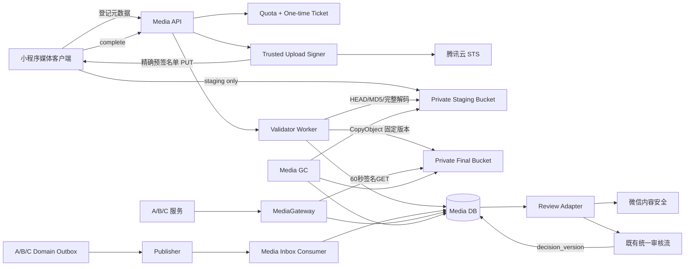
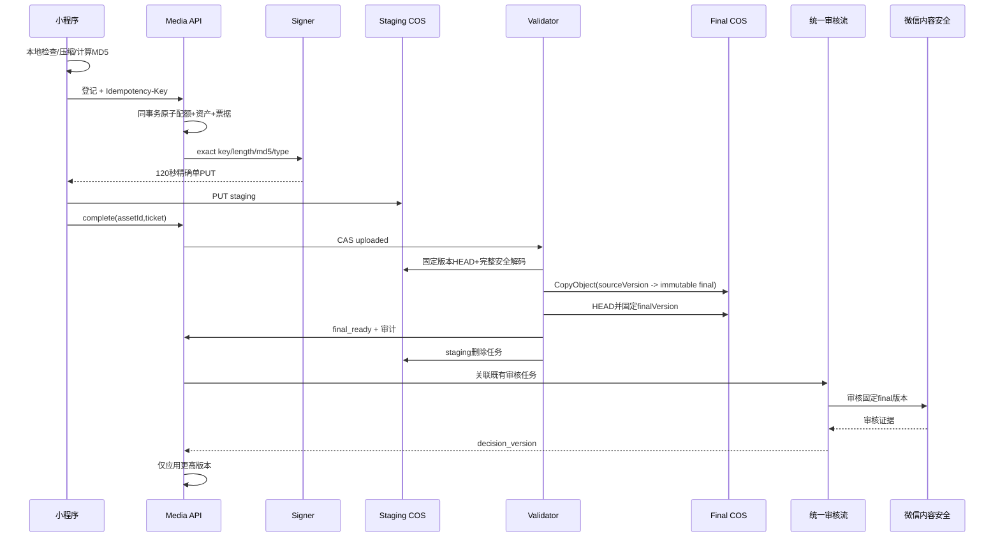
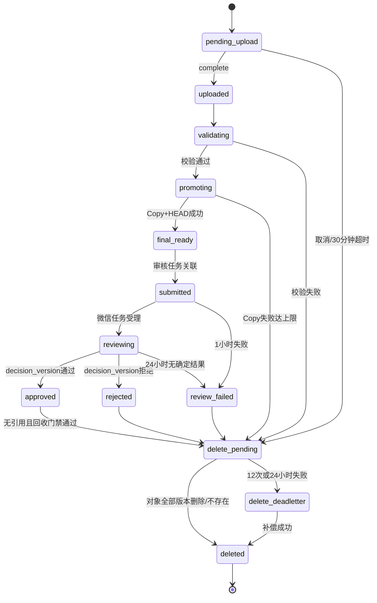

# P0-4 Media Pipeline Design v1.1（Final）

版本：v1.1 Final  
日期：2026-06-20  
设计基线：`p0-3-pass`  
整改记录：[P0-4 Design Remediation Report v1.0](./P0-4_DESIGN_REMEDIATION_REPORT_v1.0.md)  
状态：**设计整改冻结版，等待 Final 正式评审；评审 PASS 前禁止开发**

## 1. 范围与冻结声明

本设计只覆盖：

- 社区帖子图片；
- 二手商品图片；
- 用户主动修改的头像。

首次微信登录头像只允许客户端缓存显示，不创建媒体资产、不写 `avatar_asset_id`、不进入审核。

P0-1 权限体系、P0-2 社区闭环、P0-3 交易域、腾讯云 IM、搜索架构、商品状态机、通知系统和既有统一审核语义保持冻结。禁止新增视频、文件分享、相册、服务端图片压缩、多规格图片、CDN、推荐、积分、广告、支付、订单或物流。P0-5 不启动。

## 2. Final 安全不变量

1. 客户端只能写一个精确 staging Key，永远不能写 final Key。
2. 客户端不能获得可自行签名任意 COS 请求的 SecretKey。
3. 上传授权只能执行一次精确的单 PUT，并绑定 Key、Content-Length、Content-MD5、Content-Type 和禁止覆盖头。
4. multipart 的创建、分片、列举、合并和取消权限全部禁止。
5. staging 实物完成固定版本校验后，只能由后端服务角色 CopyObject 到 final。
6. final Key 内容寻址、禁止覆盖、开启版本控制；审核、展示、删除固定同一 final version。
7. 既有统一审核任务是审核事实源；媒体只保存带 `decision_version` 的投影。
8. `media_asset_references` 是引用事实源；`active_ref_count` 只作可重建缓存。
9. A/B/C 的绑定、替换、解绑必须使用同业务事务 Outbox 和 Media 幂等 Inbox。
10. 删除或替换必须先通过 revocation fence 停止旧图访问，再异步收敛引用和 COS。
11. 未审核、审核失败、未绑定、父对象不可见、撤销中或删除中的对象一律 fail-closed。
12. 物理删除必须证明无活动/待定引用、无有效绑定意图、无未决事件且保留期已到。
13. 业务服务不得直接读写媒体表或拼接 COS URL；所有读取经 MediaGateway。
14. 任一安全不变量在实现中无法满足，必须停止并重新评审，不允许局部降级。

## 3. 总体架构



### 3.1 职责边界

- Media API：登记、票据、上传授权、complete、状态查询、取消；
- Upload Signer：在可信环境使用受限 STS，客户端只拿精确预签名请求；
- Validator：验证固定 staging 版本、完整解码、计算可信 SHA-256、复制 final；
- Review Adapter：提交微信证据并接入既有统一审核流；
- Inbox Consumer：幂等维护引用和父对象可见性投影；
- MediaGateway：校验可见性并返回统一媒体访问对象；
- GC：分离治理 staging 与 final，不承担业务判断。

## 4. COS 对象与命名策略

### 4.1 Key 格式

```text
staging/<env>/<ownerShard>/<ownerPublicId>/<assetPublicId>/<uploadNonce>.<ext>
final/<env>/<purpose>/<yyyy>/<mm>/<assetPublicId>/<trustedSha256>.<verifiedExt>
```

- `ownerShard = lower(hex(SHA-256(ownerPublicId)))[0:4]`，仅用于目录均衡；
- `assetPublicId` 是 26 位大写 ULID；
- `uploadNonce` 是 128 bit CSPRNG；
- final 使用服务端完整解码后计算的可信 SHA-256；
- Key、Bucket、Region、扩展名和版本全部由服务端决定；
- 只允许 `.jpg`、`.png`、`.webp`；
- staging 和 final 使用独立私有 Bucket；如部署受限，至少必须有互斥前缀、独立权限和独立生命周期。

### 4.2 staging 最小权限

- 资源精确到单个 staging Key，不使用 owner 前缀通配；
- 只允许 `PutObject`；
- 无 GET、DELETE、LIST、COPY、ACL 或 multipart 权限；
- 请求固定 Content-Length、Content-MD5、Content-Type、`x-cos-forbid-overwrite:true`；
- 预签名 TTL 120 秒；
- Bucket 私有、开启版本控制；complete 固定具体 staging version；
- 对象创建 24 小时后清理全部当前和历史版本。

### 4.3 final 不可变

- final 只有 Media 服务角色可以 CopyObject/HEAD/GET/DeleteObject；
- CopySource 必须带已校验的 staging versionId；
- destination 禁止覆盖；同 Key 已存在时仅在可信哈希、长度和格式完全一致时视为幂等成功；
- Copy 后 HEAD 核对长度、ETag/CRC64、元数据和 final versionId；
- 微信审核、MediaGateway 和 GC 都固定 final key/version；
- final Bucket 禁止基于时间自动删除，避免误删有引用对象。

## 5. STS、上传票据与入口硬限制

客户端不接收 STS 临时 Secret。后端 Signer 取得精确资源、短 TTL、只含 PutObject 的 STS，在可信环境生成预签名单 PUT：

```json
{
  "assetId": "01JY...",
  "uploadUrl": "<120秒精确预签名PUT>",
  "requiredHeaders": {
    "Content-Type": "image/webp",
    "Content-MD5": "base64-md5",
    "x-cos-forbid-overwrite": "true"
  },
  "contentLength": 387421,
  "expiresAt": "2026-06-20T12:02:00Z"
}
```

Content-Length 必须进入 COS V5 canonical headers。修改长度、MD5、MIME、Key 或必需头应在对象完整落地前被拒绝。

### 5.1 Gate-0

真实 COS 与真实小程序网络栈的负向策略测试是开发第一门禁。必须验证：长度 ±1、错误 MD5、MIME 改写、Key 改写、final 写入、重复 PUT、过期 URL 和 multipart 全部失败。

如果 COS 不能强制精确长度和 MD5，开发必须停止，不得改为原始 STS、事后 HEAD 或事后删除。任何替代入口必须先重新完成架构评审。

### 5.2 一次性票据

票据包含 ticketId、assetId、owner、stagingKey、expectedSize、expectedMD5、declaredMime、quotaReservationId、nonce 和 expiresAt。明文只返回一次，数据库只存哈希。

```text
created -> authorization_issued -> uploaded -> consumed
       \-> expired / cancelled
```

- `credential_issue_count <= 1`；
- 票据重放返回 409；
- 授权过期或网络失败创建新票据和新 staging Key；
- approved/rejected/delete_pending/deleted 均禁止获取新授权。

## 6. 原子配额

创建资产、票据和配额 reservation 在同一 Media DB 事务完成。分钟、小时、日、pending、用户 purpose 和全局窗口使用条件更新；任一窗口失败整体回滚。

| 窗口 | 数量 | 声明字节 |
| --- | ---: | ---: |
| 每分钟 | 12 | 100 MiB |
| 每小时 | 60 | 500 MiB |
| 每日 | 200 | 1 GiB |
| 同时 pending/reviewing | 20 | 200 MiB |
| 全局 staging 每日签发 | — | 20 GiB |
| 全局 staging 每月签发 | — | 100 GiB |

`media_quota_reservations.ticket_id` 唯一，commit/release 使用 CAS，只允许结算一次。100 路并发情况下，成功请求总量不得超过任何窗口上限。

## 7. 文件与恶意内容门禁

| purpose | 文件上限 | 数量 | 最长边 | 最大像素 | 格式 |
| --- | ---: | ---: | ---: | ---: | --- |
| post_image | 10 MiB | 每帖 9 | 8192 px | 40 MP | JPEG/PNG/静态WebP |
| product_image | 10 MiB | 每商品 9 | 8192 px | 40 MP | JPEG/PNG/静态WebP |
| avatar | 5 MiB | 当前头像 1 | 4096 px | 16 MP | JPEG/PNG/静态WebP |

客户端上传前应把最长边收敛到 2048 px、优先 WebP，目标平均 400 KiB；该优化不能替代服务端校验，也不引入服务端图片压缩服务。

服务端必须：

1. HEAD 固定版本并核对长度、MD5/ETag、MIME 和 versionId；
2. 在 CPU、内存、读取字节和超时限制下完整解码；
3. 读取真实格式、width、height、像素面积和帧数；
4. 拒绝 SVG、GIF、动画 WebP、BMP、TIFF、HEIC、polyglot、截断文件和解码炸弹；
5. 完整解码后计算可信 SHA-256；
6. 展示响应使用 verified MIME 和 `X-Content-Type-Options: nosniff`。

## 8. 上传、复制与审核数据流



相同 `(owner, Idempotency-Key)` 只创建一个资产；相同键但声明元数据不同返回 409。20 路 complete 只能启动一次验证、Copy 和审核。

## 9. 审核事实源与状态机

既有统一审核任务是唯一审核事实源。媒体投影保存 `review_task_id`、`applied_decision_version`、`projected_decision` 和 `projected_decided_at`。只有更高 decisionVersion 可更新；重复、乱序、迟到或未知任务事件不改变状态。



| 状态 | TTL/重试 | 到期动作 |
| --- | --- | --- |
| pending_upload | 30 分钟 | 释放配额、删除 staging |
| validating/promoting | 1 小时，最多 5 次 | delete_pending |
| final_ready/submitted | 1 小时，最多 8 次 | review_failed |
| reviewing | 24 小时 | review_failed，始终不可见 |
| rejected/review_failed | 立即不可见 | 1 小时内请求物理删除 |
| approved 未绑定 | 24 小时 | 通过事件/intent 门禁后删除 |
| delete_pending | 12 次或 24 小时 | delete_deadletter，仍不可见 |
| Inbox 去重 | 180 天 | 到期清理 |
| 审计记录 | 365 天 | 脱敏清理 |

最终展示条件：

```text
media.status = approved
AND projected_decision = approved
AND reference.state = active
AND reference.parent_visibility = visible
AND reference.revocation_fence IS NULL
AND delete_requested_at IS NULL
AND final_key/final_version_id 已固定
```

任何条件未知均按 false。

## 10. 引用模型、Outbox 与上传事务一致性

### 10.1 标准化引用

`media_asset_references` 字段包含 assetId、referenceType、referenceId、slot、state、parentVisibility、aggregateVersion、operationId、revocationFence 和时间戳。

唯一约束：

- `(reference_type, reference_id, slot)`；
- `(asset_id, reference_type, reference_id, slot)`。

引用行为事实源。`active_ref_count` 只作缓存，必须可由引用行重建，GC 不得只凭计数删除。

### 10.2 Outbox/Inbox

A/B/C 在父对象创建、编辑、删除的同一事务写 Domain Outbox。允许的媒体事件仅为：

- `MediaReferenceSetRequested`；
- `MediaReferenceReplaceRequested`；
- `MediaReferenceRevokeRequested`；
- `MediaParentVisibilityChanged`。

事件包含 eventId、operationId、aggregateType、aggregateId、aggregateVersion、owner、目标引用集合和目标可见性，不包含图片字节、COS URL 或密钥。

Media Consumer 在一个媒体事务内：

1. eventId 插入 Inbox，冲突视为幂等成功；
2. 锁定父对象引用投影；
3. 低版本忽略；同版本相同 payload 幂等；同版本不同 payload 进入 dead-letter；
4. 高版本应用目标引用集合；
5. 重算引用计数缓存并写审计。

### 10.3 Revocation Fence

删除/替换事务前，业务服务调用 MediaGateway 建立 2 分钟 fence，使旧引用立即不可访问。fence 创建失败则业务变更 fail-closed。事务提交后 Outbox 把 fence 固化为 revoked；事务回滚则 best-effort 取消，取消失败最多两分钟自动解除。

这只是媒体可见性钩子，不改变帖子、商品、头像、权限或审核的业务规则。

## 11. 数据库设计

本节只定义未来迁移，Final 评审前不得创建迁移文件。

### 11.1 核心表

- `media_assets`：owner、purpose、staging/final key+version、声明/验证 MIME 和 size、MD5、可信 SHA-256、尺寸、状态、审核投影、引用计数缓存、TTL、删除和 CAS 版本；
- `media_upload_tickets`：ticketHash、assetId、精确上传条件、状态、授权次数、配额 reservation、过期时间；
- `media_quota_windows`：scope、window、reserved/used count/bytes；
- `media_quota_reservations`：ticketId 唯一，reserved/committed/released；
- `media_asset_references`：标准化引用事实；
- `media_bind_intents`：operationId、资产集合 hash、15 分钟预占；
- `media_event_inbox`：eventId、aggregateVersion、payloadHash、应用状态；
- 各域 `domain_outbox`：与父对象同事务写入；
- `media_gc_jobs`：对象阶段、固定 key/version、lease、attempts、deadletter；
- `media_asset_audits`：全部状态、票据、配额、引用和删除变化。

### 11.2 关键约束/索引

- UNIQUE media publicId、stagingKey、finalKey、reviewTaskId；
- UNIQUE `(owner_user_id,idempotency_key)`；
- UNIQUE ticketHash、ticket.assetId、quota.ticketId、inbox.eventId、outbox.eventId；
- INDEX `(status,upload_expires_at,id)`、`(status,review_deadline_at,id)`、`(status,delete_requested_at,id)`；
- INDEX `(asset_id,reference_state)`、`(reference_type,reference_id,state)`；
- 不建立 A/B/C 业务表与媒体表的跨域外键，不允许媒体仓储直查业务表。

## 12. 软删除、物理删除与孤儿治理

### 12.1 staging 回收

1. 超限、MD5 错误、恶意格式：立即删除；
2. Copy 成功：15 分钟内删除 staging；
3. pending 超时、票据过期、用户取消：1 小时内删除；
4. Bucket 生命周期：24 小时删除全部版本。

### 12.2 final 回收

审核拒绝和 review_failed 立即停止访问，1 小时内进入删除。approved 对象只有同时满足下式才可物理删除：

```text
无 active/pending/revoking 引用
AND 无有效 bind intent
AND 无未消费/冲突 reference event
AND active_ref_count 对账为 0
AND retention deadline 已到
AND delete_requested_at 已登记
```

GC 使用 lease + CAS；删除固定 final version 及对应历史版本。NoSuchKey/NoSuchVersion 视为幂等成功。12 次或 24 小时失败进入 dead-letter，但资源继续不可访问。

### 12.3 对账

媒体域只通过 Inbox、引用表及各域公开快照事件对账，不直查用户、帖子或商品表。无法证明无引用时一律不删。对账修复计数缓存并请求缺失 aggregateVersion 重放。

## 13. MediaGateway、签名 URL 与 CORS

业务层只获得：

```json
{
  "mediaId": "01JY...",
  "referenceId": "01JZ...",
  "accessPath": "/api/v1/media/references/01JZ.../content",
  "mimeType": "image/webp",
  "width": 1440,
  "height": 1080
}
```

业务响应禁止出现 Bucket、Region、objectKey、versionId、永久 URL、签名 URL、STS 或 Secret。MediaGateway 通过可见性公式后，302 到绑定 final version 的 60 秒签名 GET，`Cache-Control: private,max-age=45`；删除后的最长残留窗口为 60 秒。

生产 staging CORS：

- 精确 AllowedOrigins，禁止 `*`；
- 仅 PUT；
- 仅 Content-Type、Content-MD5、禁止覆盖头和签名所需最小头；
- 仅暴露 ETag、requestId、versionId；
- MaxAge 300 秒；
- 无 Cookie/credentials，无 GET/POST/DELETE/LIST。

## 14. API 清单

| 方法 | 路径 | 鉴权/约束 | 说明 |
| --- | --- | --- | --- |
| POST | `/api/v1/media/uploads` | 登录、Idempotency-Key、原子配额 | 资产、票据、精确单PUT |
| POST | `/api/v1/media/uploads/:id/complete` | owner、票据、状态CAS | 服务端验证实物 |
| GET | `/api/v1/media/uploads/:id` | owner、读限流 | 状态与恢复动作 |
| DELETE | `/api/v1/media/uploads/:id` | owner且未绑定、幂等 | 取消并回收 |
| GET | `/api/v1/media/references/:id/content` | 父对象可见性 | 60秒受控读取 |
| POST | `/api/v1/media/wechat/callback` | 微信签名、trace、版本 | 审核证据接入 |
| POST | `/internal/media/bind-intents` | A/B/C服务身份 | 原子预占 approved 资产 |
| POST | `/internal/media/revocation-fences` | A/B/C服务身份 | 删除/替换前阻断 |
| DELETE | `/internal/media/revocation-fences/:op` | A/B/C服务身份 | 回滚补偿 |

统一使用现有返回规范和权限模型，不新增角色或改动权限语义。

## 15. 去重、并发和异常恢复

- 请求幂等键与内容哈希分离；
- 可信 SHA-256 只由服务端完整解码后产生；
- 只允许同用户、同 purpose 复用 approved canonical asset，禁止跨用户去重；
- 20 路登记只创建 1 资产、1 票据和 1 次配额预占；
- 20 路 complete 只执行 1 次验证、Copy 和审核；
- 多图 bind intent 全成全败；
- Outbox/Inbox 承受至少一次投递、重复、乱序和延迟；
- 客户端保存 assetId，断网或重启后查询状态；授权过期则重新登记，不复用旧 Key；
- GC、Copy、审核提交均使用幂等键和 lease/CAS。

## 16. 成本预算

假设每活跃用户每月 3 张、平均 400 KiB、p95 1.5 MiB、无服务端多规格副本：

| 用户规模 | 月上传 | 月新增 final | 12月未删累计 |
| --- | ---: | ---: | ---: |
| 1 万 | 3 万张 | 约 11.7 GiB | 约 140.6 GiB |
| 2 万 | 6 万张 | 约 23.4 GiB | 约 281.3 GiB |

2 万用户下行预算：

| 场景 | DAU | 每活跃用户每日浏览 | 月 GET | 月下行 |
| --- | ---: | ---: | ---: | ---: |
| 保守 | 10% | 20 | 120 万 | 约 458 GiB |
| 基准 | 20% | 50 | 600 万 | 约 2.24 TiB |
| 压力 | 30% | 100 | 1800 万 | 约 6.71 TiB |

预算必须包含存储、PUT/HEAD/COPY/GET/DELETE、微信审核和公网下行。平均图片超过 400 KiB、p95 超过 1.5 MiB、staging 残留超过 final 月新增的 1% 或下行进入更高档时重新容量评审；本阶段不得因此擅自引入 CDN 或服务端压缩。

## 17. Final 验收矩阵

### 17.1 COS/STS

- 精确单 PUT 成功；长度±1、错误MD5、改MIME、改Key、写final全部失败；
- multipart 全部操作失败；
- 旧授权重放不能改变 final；
- 审核与展示对象的 key/version/hash 完全一致；
- CORS 非白名单 Origin 和额外方法/头失败。

### 17.2 审核与恶意文件

- JPEG/PNG/静态WebP 正常；伪MIME、SVG、GIF、动画WebP、截断、polyglot、解码炸弹拒绝；
- 旧/重复/乱序 decisionVersion 不回退；
- 微信延迟、超时或失败始终不可见并按 TTL 收敛；
- rejected 无法通过任何业务接口或旧引用展示。

### 17.3 事务与引用

- 父对象事务成功、Publisher 宕机：恢复后最终绑定，期间不误删；
- 删除事务提交、Consumer 停机：fence 立即阻断，恢复后 revoked；
- 替换事务回滚：fence 最多 2 分钟解除，旧对象不被物理删除；
- 事件重复、乱序、延迟：最终状态等于最高 aggregateVersion；
- GC 与绑定并发：intent/未决事件存在时不误删；
- 人工扰乱引用计数：对账可重建，GC 不根据错误缓存删除。

### 17.4 配额、并发和 GC

- 100 路并发不突破任何次数/字节窗口；
- 20 路幂等登记和 complete 不产生重复对象或审核；
- Copy 后 staging 失败可重试，24 小时生命周期兜底；
- rejected、孤儿和解绑对象按 TTL 回收；
- 多实例 GC 通过 lease/CAS 幂等；
- 删除失败进入 dead-letter 且始终不可访问。

### 17.5 边界与工程门禁

- A/B/C 无跨域表访问，无 COS URL 拼接；
- 首次微信登录头像不创建媒体资产；
- P0-1/P0-2/P0-3 行为回归无变化；
- 设计 Final 正式评审 PASS 后才允许创建迁移和代码；
- 开发完成后必须进行真实 COS、真实微信验收并另行输出专项验收报告；
- P0-5 仍不得启动。

## 18. 风险关闭与停线条件

| 风险组 | Final 设计状态 |
| --- | --- |
| 3 项 High Risk | 设计层全部关闭 |
| 9 项 Medium Risk | 设计层全部关闭 |
| 低风险治理项 | 已进入 ID、分片、审计、生命周期、缓存和历史兼容约束 |

出现以下任一情况必须停线并重新评审：

- 客户端需要拿原始 STS Secret；
- 入口无法强制长度/MD5而计划改为事后删除；
- final 可覆盖或读取未固定版本；
- A/B/C 无法同事务写 Outbox；
- 删除/替换无法先 fence；
- GC 只能依赖引用计数；
- 需要修改冻结权限、审核、社区、交易、搜索、状态机或 IM；
- 计划提前进入 P0-5。

## 19. Final 冻结结论

本文件是 P0-4 设计整改后的 Final 冻结候选。所有 High Risk 与 Medium Risk 已在设计层形成明确、可实现、可自动化验证的闭环。

当前状态仍是：**禁止开发**。只有本 Final 版经正式架构评审明确判定 PASS 后，才能进入 P0-4 开发；设计评审 PASS 不代表 P0-4 专项验收 PASS。任何后续设计变更都必须升级版本并重新评审。P0-5 继续禁止启动。
